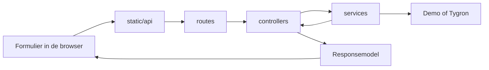

# Zelf wijzigingen maken in ScenarioDossier

Begin met een kleine wijziging, bijvoorbeeld een tekst of een instelling. De onderstaande tabel vertelt welk bestand je
daarvoor nodig hebt. Je hoeft de technische opbouw van ZIP of GeoPackage niet te kennen om de interface te wijzigen.

## Waar pas ik iets aan?

| Wat wil je wijzigen?                                          | Begin hier                                                                    |
|---------------------------------------------------------------|-------------------------------------------------------------------------------|
| Een Nederlandse of Engelse tekst                              | `translations/nl.json` en `translations/en.json`                              |
| Het loginformulier                                            | `templates/login.html`                                                        |
| Het formulier voor een actieve sessie                         | `templates/active-session.html`                                               |
| De projectlijst                                               | `templates/projects.html` en `static/projects.js`                             |
| Zoekfilters en selectievakjes                                 | `static/workflow/selection-panel.js`                                          |
| De regels waarmee een onderdeel wordt gevonden                | `static/review-selection.js`                                                  |
| De bronkeuze of verbinding met een sessie                     | `static/workflow/source-form.js`                                              |
| De velden van het dossierformulier                            | `templates/index-new.html` en `static/workflow/dossier-form.js`               |
| Het successcherm                                              | `static/workflow/export-result.js`                                            |
| Kleuren en foto’s                                             | `static/province.css` en `static/workflow-hero.css`                           |
| De kaartpreview                                               | `static/scenario-map.js`                                                      |
| Cacheduur, exportmap of aantal gelijktijdige previews         | `scenario_dossier/config.py`                                                  |
| De inhoud van het HTML-rapport in de ZIP                      | `templates/reports/dossier.html` en `templates/reports/components/table.html` |
| Welke bestanden in het dossier komen                          | `scenario_dossier/exporting/archive.py`                                       |
| Controles op een bestaand dossier                             | `scenario_dossier/validation.py`                                              |
| Welke API-velden verplicht zijn of een standaardwaarde hebben | `scenario_dossier/models/api/requests/`                                       |
| Welke API-velden naar de browser mogen                        | `scenario_dossier/models/api/responses/`                                      |

## De code lezen

Dezelfde handeling gaat steeds langs deze onderdelen:



Een **route** koppelt een URL aan een handeling. Een **controller** regelt toegang en bouwt het antwoord. Een **service
** voert het werk uit, zoals een project openen of een dossier maken. Een **model** beschrijft de gegevens die daarbij
horen. De HTML in `templates/` en de JavaScript-bestanden in `static/` vormen de weergave.

Deze scheiding heet MVC met services. Het voordeel is dat een verandering aan de vormgeving geen wijziging in de
Tygron-koppeling nodig heeft. DRY betekent hier dat gedeelde controles, HTTP-aanroepen en bronconversies één vaste
implementatie hebben.

`web.py` verbindt de onderdelen wanneer de app start. De daadwerkelijke handelingen staan in de afzonderlijke bestanden.
`http/` bevat gedeelde verwerking van verzoeken, antwoorden, sessies en fouten. Normaal gesproken hoef je die map niet
te wijzigen.

## De app starten en controleren

Voer de opdrachten uit vanuit de hoofdmap van het project:

```bash
python3 -m venv .venv
.venv/bin/python -m pip install -r requirements.txt
.venv/bin/python app.py
```

Open vervolgens `http://127.0.0.1:8080/`. Stop de server met Ctrl+C en start hem opnieuw na wijzigingen aan Python,
templates of vertaalbestanden. Vernieuw de browser na wijzigingen aan JavaScript of CSS. Debugmodus is niet nodig voor
deze werkwijze.

De controles voer je uit met:

```bash
.venv/bin/python scripts/generate_api_models.py
.venv/bin/python -m unittest discover -s tests
.venv/bin/python scripts/generate_api_models.py --check
```

De browserlogica heeft ook tests in JavaScript. Gebruik hiervoor Node 18 of nieuwer. De Python-tests starten deze
controles wanneer Node beschikbaar is. Een overgeslagen Node-test betekent dat die controle op die computer niet is
uitgevoerd.

## Voorbeeld 1: een tekst veranderen

Zoek bijvoorbeeld `Dossiereigenaar` op in `translations/nl.json`. Verander de waarde naar `Verantwoordelijk team`. Laat
de sleutel links van de dubbele punt staan. Pas daarna de bijbehorende Engelse waarde in `translations/en.json` aan.

De sleutel verbindt de tekst met de HTML en JavaScript. Door de sleutel te behouden blijven alle verwijzingen werken.
Namen en beschrijvingen uit Tygron zijn brongegevens en worden niet door deze vertaalbestanden aangepast.

## Voorbeeld 2: een instelling veranderen

Open `scenario_dossier/config.py`. Daar staan onder andere:

| Instelling                   | Betekenis                                                       |
|------------------------------|-----------------------------------------------------------------|
| `EXPORT_DIR`                 | Map voor gemaakte ZIP-dossiers                                  |
| `AUTH_SESSION_LIFETIME`      | Levensduur van een browsersessie in seconden                    |
| `THUMBNAIL_CONCURRENCY`      | Aantal previews dat gelijktijdig mag worden gemaakt             |
| `THUMBNAIL_LIFETIME`         | Cacheduur van een geldige preview in seconden                   |
| `THUMBNAIL_FAILURE_LIFETIME` | Wachttijd voordat een mislukte preview opnieuw wordt geprobeerd |
| `THUMBNAIL_CAPACITY`         | Maximaal aantal previews in de cache                            |
| `MAP_STYLE_URL`              | Adres van de kaartstijl                                         |

`24 * 60 * 60` is 24 uur in seconden. Voor een cacheduur van 12 uur kun je dit veranderen naar `12 * 60 * 60`. Dezelfde
instelling wordt gebruikt voor het geheugen en de schijfcache.

## Voorbeeld 3: de API voor projectkeuze volgen

Een accountproject wordt opgevraagd via `GET /api/tygron/projects`.

1. `static/api/projects.js` bevat `getAccountProjects()`. De pagina hoeft de URL niet zelf te kennen.
2. `routes/projects.py` koppelt de URL aan `AccountProjectsRequest` en `ProjectsResponse`.
3. `controllers/project_controller.py` vraagt de beschikbare projecten op en maakt veilige responsemodellen.
4. `services/project_service.py` beheert de projectlijst van het account.
5. `services/tygron_service.py` gebruikt de bestaande Tygron-client.

De hoofdregel voor een nieuwe API is hetzelfde: benoem eerst het payloadmodel en het antwoordmodel, gebruik een
controller voor de handeling en gebruik de gedeelde HTTP-client in de browser. Kopieer geen `fetch()` of `urllib`-code
naar een pagina of route.

Een route ziet er bijvoorbeeld zo uit:

```python
@api_endpoint(api, '/inspect', InspectRequest, InspectResponse, method='POST')
def inspect(payload):
    return current_app.extensions['controllers']['workflow'].inspect(
        payload, g.account, g.language
    )
```

`api_endpoint` leest de JSON, maakt `InspectRequest` en controleert dat de handeling een `InspectResponse` teruggeeft.
De route hoeft dit niet zelf te herhalen. Dat staat één keer in `http/contracts.py`.

Een requestmodel heeft benoemde velden in plaats van losse dictionarysleutels:

```python
@dataclass(frozen=True)
class LoginRequest(JsonModel):
    username: str
    password: str = field(repr=False)
    base_url: str = 'https://engine.tygron.com'
    domain: str = ''
```

`str` betekent tekst. Een veld zonder standaardwaarde moet bij het maken van het model worden aangeleverd. `repr=False`
zorgt ervoor dat het wachtwoord niet in de normale tekstweergave van het model verschijnt. `from_dict()` controleert de
ontvangen waarden. Gedeelde controles zoals `text()` en `boolean()` staan in `models/api/base.py`.

GET-verzoeken hebben ook een requestmodel. Soms is dit leeg omdat er geen velden nodig zijn. Een download heeft het veld
`name` uit de URL. Een validatieverzoek bevat ZIP-bytes in plaats van JSON. Het model beschrijft dat verschil expliciet.

## Voorbeeld 4: een dossiergegeven toevoegen

Stel dat je een optioneel veld `contactpersoon` wilt toevoegen. Dit is een uitbreiding van het formulier én van het
opgeslagen dossier:

1. Voeg een invoerveld met een uniek ID toe aan `templates/index-new.html`.
2. Voeg de Nederlandse en Engelse labels toe aan de vertaalbestanden.
3. Lees het veld in `static/workflow/dossier-form.js` uit onder de sleutel `contactpersoon`.
4. Voeg `contactpersoon: str = ''` toe aan `models/dossier/dossier_details.py`.
5. Voeg het gegeven toe aan `record` in `exporting/archive.py`. Dit bepaalt wat in `metadata/dossier.json` wordt
   opgeslagen.
6. Voeg hetzelfde veld toe aan `RecordMetadataResponse` in `models/api/responses/workflow.py`. Dit bepaalt wat de
   browser over het dossier terugkrijgt.
7. Toon het gegeven waar nodig in `templates/reports/dossier.html`. `exporting/report.py` levert de rapportgegevens aan
   de template.
8. Voeg een exporttest toe die controleert dat de waarde werkelijk in de ZIP en het rapport staat.
9. Bouw de API-documentatie en browsertypes opnieuw op en voer de tests uit.

Het formulier, de API en het rapport hebben elk een eigen verantwoordelijkheid. Daardoor kun je bijvoorbeeld een veld
wel bewaren en ervoor kiezen het niet in het rapport te tonen. Maak een veld alleen verplicht als zowel het requestmodel
als de dossiercontrole dat ondersteunen.

Het geëxporteerde HTML-rapport is een gewone Jinja-template. Je kunt teksten, HTML en CSS aanpassen zonder Python-code
te herschrijven. Variabelen worden automatisch ge-escaped. Laat die automatische escaping aan staan. Het rapport blijft
zelfstandig leesbaar, zonder een draaiende webserver.

## API-modellen bijwerken

[API_MODELLEN.md](API_MODELLEN.md) bevat alle eigen URL’s en de velden van hun modellen. Het bestand en de browsertypes
in `static/api/models/requests.js` en `responses.js` worden gegenereerd. Pas de Python-modellen aan en voer de generator
uit. Bewerk de gegenereerde bestanden niet met de hand.

De JavaScript-functies verwijzen met `@param` en `@returns` naar deze modellen. Een editor kan daardoor veldnamen en
typen tonen tijdens het programmeren. De Python-requestmodellen voeren daarnaast echte controles uit op ontvangen
invoer. Typehints vervangen die controles niet.

Een test controleert dat iedere eigen API-route een contract heeft en dat de gegenereerde bestanden actueel zijn. Een
andere test controleert dat de schermen geen losse `fetch()`-aanroepen bevatten.

## De Tygron-koppeling wijzigen

De eigen API en de Tygron-API zijn verschillende grenzen. Hun modellen staan daarom in verschillende mappen:

```text
scenario_dossier/models/
├── api/
│   ├── requests/       Velden die de browser mag aanleveren
│   └── responses/      Velden die naar de browser mogen
├── tygron/api/
│   ├── requests/       Verzoeken aan Tygron
│   └── responses/      Antwoorden van Tygron
├── auth/              Inloggegevens en interne accountsessie
├── scenario/          Projectinhoud, selectie en controlegegevens
├── project/           Projectnamen en actieve versies
└── dossier/           Dossiergegevens en resultaat van bestandscontroles
```

Zie [TYGRON_API_MODELLEN.md](TYGRON_API_MODELLEN.md) voor de externe aanroepen. `integrations/tygron/transport.py`
regelt HTTP en foutafhandeling. `tygron.py` koppelt iedere aanroep aan zijn modellen. `services/tygron_service.py`
regelt wanneer projecten worden geopend en weer gesloten.

Behoud de `with`-blokken rond tijdelijke projectsessies. Die sluiten een sessie ook als inspectie, WMS of export
mislukt. Accountcredentials komen uitsluitend uit de server bij accountprojecten. Ze worden niet uit een browserantwoord
teruggelezen.

## Comments en naamgeving

Schrijf korte comments die de reden voor een keuze uitleggen. Gebruik geen em dash of puntkomma in comments. De eigen
Python-comments, docstrings en de comments in de interfacebestanden worden hierop gecontroleerd. Bestanden van externe
bibliotheken in `static/vendor/` vallen buiten deze regel.

Gebruik beschrijvende namen zoals `project_file`, `InspectRequest` en `ProjectService`. Vermijd nieuwe afkortingen of
een algemene map waarin ongerelateerde hulpfuncties terechtkomen.

## Oude importpaden

`http_routes.py`, `exporter.py` en `app-flask.py` bestaan nog voor bestaande aanroepen. Ze verwijzen naar de huidige
implementatie. Voeg nieuwe logica toe in de betreffende onderwerpmap. `validation.py` blijft de centrale dossiercontrole
en kan ook vanaf de opdrachtregel worden gebruikt.
