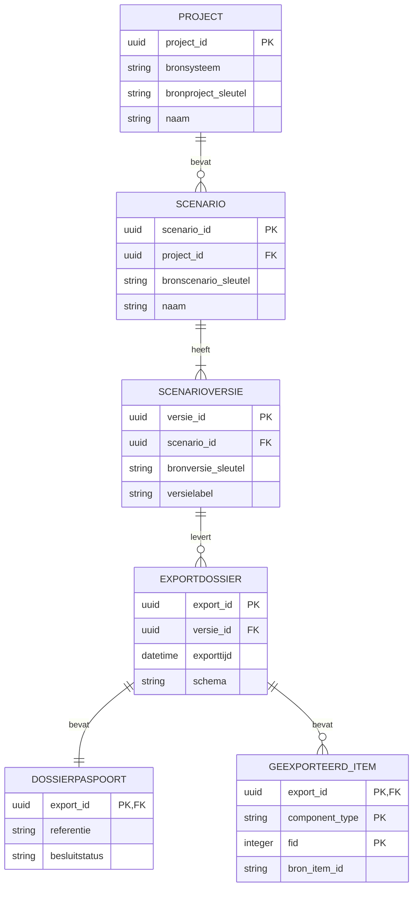

# ERD en exporttoets voor ScenarioDossier

De [geteste demo-export](ScenarioDossier-demoproef-92-94.zip) koppelt het dossier aan de project- en scenarionaam en
bevat de verwachte 21 onderdelen. Voor blijvende herleidbaarheid ontbreekt een stabiele bronversie-ID. Het ERD geeft aan
welke sleutels nodig zijn om verschillende exports van dezelfde versie te
herkennen. [Trello #94](https://trello.com/c/LA21HrGB/94-erd-toetsen-aan-een-scenariodossier-export)

## Voorgesteld logisch model

[Open het ERD als afbeelding](ERD-ScenarioDossier.svg)

Elk exportdossier legt precies één bronversie vast. Een vastgelegde versie kan in meerdere dossiers terechtkomen,
bijvoorbeeld bij een andere selectie. Elk dossier heeft één momentopname van het dossierpaspoort. Een dossier kan nul of
meer onderdelen bevatten. De samengestelde sleutel voor onderdelen combineert dossier-ID, componenttype en `fid`, omdat
`fid` lokaal binnen een tabel wordt toegekend. `bron_item_id` kan leeg zijn. Bronreferenties moeten binnen de
gedocumenteerde scope van hun bronsysteem worden gelezen.

## Aansluiting op de huidige export

| Relatie             | Wat het prototype vastlegt                                                                                                                        | Wat nog nodig is                                                                                                                                               |
|---------------------|---------------------------------------------------------------------------------------------------------------------------------------------------|----------------------------------------------------------------------------------------------------------------------------------------------------------------|
| Project -> scenario | Bij de demo selecteert de gebruiker met project- en scenario-ID’s. `dossier.json` bewaart de labels `project` en `scenario`.                      | Stabiele project- en scenarioreferenties in het exportcontract opnemen en hun bronscope bevestigen.                                                            |
| Scenario -> versie  | Bij de Tygron-projectroute gebruikt het prototype de actieve versienaam als scenariolabel. Bij de demo is dit `Groen & Gezond 2040`.              | Met Tygron en de opdrachtgever vaststellen hoe scenario en versie in de bron worden onderscheiden en welke sleutel voor een historische versie beschikbaar is. |
| Versie -> dossier   | `source`, `exported_at`, `schema`, `software` en het SHA-256-manifest beschrijven de herkomstcategorie, export en bestanden.                      | Een stabiele bronversiereferentie en een eigen export-ID meenemen. De tijd en hash kunnen de proefexport terugvinden.                                          |
| Dossier -> paspoort | `record` en `decision` zijn onderdeel van hetzelfde `dossier.json`. De proef gebruikt referentie `INNO-S4-DEMO-001` en besluitstatus `Demoproef`. | Gebruik de export-ID als koppeling. De ingevoerde referentie blijft een zakelijk veld met nog onbepaalde uniciteit.                                            |
| Dossier -> item     | Het ZIP-bestand groepeert de vier tabellen. Elke tabel heeft `fid`, `item_id` en `source_json`.                                                   | Koppel een item logisch via export-ID, tabel en `fid`. Bewaar `item_id` als optionele bronreferentie.                                                          |

[Selectie en context](../scenario_dossier/services/workflow_service.py) · [Tygron-projectroute](../scenario_dossier/controllers/workflow_controller.py) · [Exportmetadata](../scenario_dossier/exporting/archive.py)

## Toets met een demo-export

- **Invoer.** `Merwedekanaalzone -> Groen & Gezond 2040`, alle vier voor het dossier relevante componenten, zonder
  rasters. Dit zijn fictieve demogegevens. [Demodata](../data/demo.json)
- **Uitvoer.** Gemaakt op 16 november 2026 om 19.29 uur Nederlandse tijd. De validator keurde het ZIP-bestand goed met
  20 geslaagde controles en 0 fouten. Het manifest controleerde ook de bestandsinhoud. `PRAGMA integrity_check` op
  `gis/scenario.gpkg` gaf `ok`.
- **Koppelingen.** Alle 21 `item_id`-waarden en opgeslagen eigenschappen in `source_json` komen overeen met de bronnen
  in `bron/`. De ruimtelijke subsets sluiten aan op de GeoJSON-bestanden en gebruiken EPSG:4326. `fid = 1` komt in elke
  tabel voor. De export bevat alleen het scenariolabel om de gebruikte versie te beschrijven.

| Tabel        | Records | Met geometrie | Voorbeeld `item_id` bij `fid = 1`      |
|--------------|--------:|--------------:|----------------------------------------|
| `overlays`   |       5 |             0 | `11` · Hittestress gevoelstemperatuur  |
| `indicators` |       6 |             0 | `21` · Inwoners binnen 300 m van groen |
| `measures`   |       6 |             6 | `31` · Parklint langs kanaal           |
| `alerts`     |       4 |             2 | `41` · Hittestress bij schoolplein     |

### Herhalen voor de review

1. Open `/controle` in ScenarioDossier en selecteer het [demo-ZIP-bestand](ScenarioDossier-demoproef-92-94.zip).
   Controleer de pakketvalidatie.
2. Pak het bestand uit en zoek in `metadata/dossier.json` naar `project`, `scenario`, `exported_at` en
   `record.reference`. Leg de teruggevonden velden naast het model. Controleer of je een onveranderlijke verwijzing naar
   de gebruikte bronversie kunt aanwijzen.
3. Open `gis/scenario.gpkg` in QGIS en vergelijk de lagen en tabellen met de tellingen. Met SQLite kun je bijvoorbeeld
   `SELECT fid, item_id FROM measures WHERE item_id = '31';` uitvoeren. Vergelijk de uitkomst met `bron/measures.json`.

SHA-256 van het geteste ZIP-bestand `480f452d82f345a9f3d765dfe3684c78abe0f20e881c35642c09b4bcafb9e778`.

## Besluitvraag voor de opdrachtgever

**Moet een beheerder dezelfde historische Tygron-versie opnieuw kunnen opvragen, of volstaat het om de gearchiveerde
gegevens en hun herkomst te kunnen verifiëren?** Bepaal daarna welke bronreferentie verplicht is. Als de bron geen
onveranderlijke versie-ID levert, werk dan uit welk bewijs nodig is voor een verifieerbare momentopname en hoe de export
een onbekende bronversie vastlegt. De toets door een tweede teamlid staat open.
