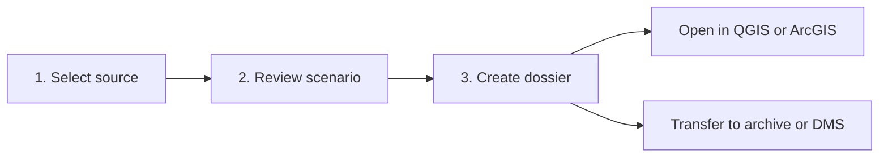
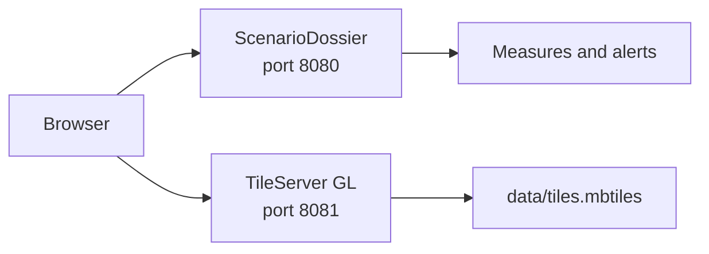

# ScenarioDossier user guide



## 1. Create a dossier

Install the dependencies with `python3 -m pip install -r requirements.txt`, start the application with `python3 app.py`
and open `http://127.0.0.1:8080`.

### Log in and select a project

1. Enter your Tygron username and password and choose **Log in**. An existing login key can also be used; for accounts
   with two-factor authentication, contact Tygron Support about API access.
2. Under **Connection settings**, you can change the Tygron URL or enter a domain. If omitted, the domain is read from
   your account.
3. Find your project by name in **Projects** and select its row.
4. Selecting a project opens **Step 3: Map and selection** directly. Review the active project version and choose the
   items to export. After export, **Step 4: Success** shows the download.
5. Follow steps 4–8 below. The temporary project session is closed after each review or export.
6. Choose **Log out** when finished. App sessions expire after 30 minutes; login keys are kept only in server memory.
   Passwords are used only to obtain a login key.

The **NL / EN** buttons change the interface language. The choice remains available across pages and browser refreshes.
The dossier format and source data are unchanged.

### Demo

1. Choose **Open demo** on the login page. Step 2 shows the project dashboard.
2. Select a project row to open the map and item selection in step 3.
3. Optionally choose another scenario in the scenario field above the selection.
4. Review the counts and map preview.
    - Use **Measures** and **Alerts** to show or hide individual map layers.
    - Click a point, line or polygon to view its name, status and description.
    - Search **Items in dossier** by name, type or status.
    - Select or deselect individual overlays, indicators, measures and alerts. The counter shows how many records will
      be included; excluded spatial records disappear from the map.
    - Click a spatial record's name to centre the map on it. A previously deselected object is automatically selected. *
      *All** and **None** update the entire selection.
    - **OpenMapTiles active** means the local basemap is loaded. When **Basemap unavailable** is shown, scenario objects
      remain visible against a neutral background.
5. Record the reasons for the decision under **Notes and considerations**.
6. Open **Dossier passport** and review reference, owner, author, decision date and status, alternatives, classification
   and retention period.
7. Review the individual selection in **Items in dossier** and choose **Create dossier**. Only selected records are
   written to JSON, CSV, GeoJSON, GeoPackage, the report and any raster exports.
8. Download the ZIP file and transfer it to the designated dossier location.

### Install a local OpenMapTiles basemap

OpenMapTiles is optional: export, validation and selection work without a basemap. A local basemap makes it easier to
check where measures and alerts are located. MapLibre is included in ScenarioDossier; map tiles and the local tile
server are configured separately.



#### 1. Install prerequisites

Install before starting:

- **Docker Desktop** on macOS or Windows, or Docker Engine on Linux;
- **Docker Compose v2** (`docker compose`);
- **Git**, **Make** and **Bash**;
- approximately 15 GB of free disk space and preferably 8 GB of memory for a small extract.

Start Docker Desktop and check in a terminal:

```bash
docker --version
docker compose version
docker info
git --version
make --version
```

All commands should finish without errors. On Windows, prefer WSL2 and store OpenMapTiles in the Linux file system, for
example `/home/<user>`, rather than `/mnt/c`.

#### 2. Place OpenMapTiles next to ScenarioDossier

This guide assumes two adjacent directories:

```text
INNO/
├── project/          ScenarioDossier
└── openmaptiles/     OpenMapTiles
```

From the project directory, go up one level and clone OpenMapTiles:

```bash
cd ..
git clone https://github.com/openmaptiles/openmaptiles.git
cd openmaptiles
```

If `openmaptiles` already exists, skip `git clone` and enter that directory directly.

#### 3. Set the level of detail

Open `openmaptiles/.env` and check these values:

```dotenv
MIN_ZOOM=0
MAX_ZOOM=14
MBTILES_FILE=tiles.mbtiles
```

Zoom level 14 is needed to recognise streets and buildings in an area development project. Use it for a small extract. A
full Netherlands tile set at zoom level 14 requires considerably more processing and storage. Start with `MAX_ZOOM=12`
for a quicker trial if needed.

#### 4. Download Utrecht data and generate tiles

The route for the demo and Utrecht projects uses the compact Utrecht extract from BBBike:

```bash
./quickstart.sh Utrecht bbbike
```

This downloads Docker images and OpenStreetMap data, builds the database and writes:

```text
openmaptiles/data/tiles.mbtiles
```

The first run can take a long time. Keep the terminal open and prevent the computer from sleeping. Progress and errors
are also recorded in `openmaptiles/quickstart.log`.

Be aware that `quickstart.sh` removes the previous database and the existing file named by `MBTILES_FILE` within the
OpenMapTiles installation. Copy an existing tile set to a safe location first if you need to retain it.

For scenarios outside the Utrecht extract:

- select a custom rectangle or polygon using the BBBike extract service and place the `.osm.pbf` file in
  `openmaptiles/data/`;
- or use `./quickstart.sh netherlands geofabrik` for the Netherlands and increase `MAX_ZOOM` in small steps.

List the available Geofabrik areas with:

```bash
make list-geofabrik
```

#### 5. Use an existing MBTiles file

If you already have an OpenMapTiles-compatible MBTiles file, skip step 4. Place it at:

```text
openmaptiles/data/tiles.mbtiles
```

The filename must match `MBTILES_FILE` in `.env` and `/data/tiles.mbtiles` in `style/config.json`. An arbitrary raster
MBTiles file will not work: the included style expects vector tiles following the OpenMapTiles schema.

#### 6. Start the tile server

Run the tile server from `openmaptiles`. Port 8081 avoids a conflict with ScenarioDossier on port 8080:

```bash
TPORT=8081 make start-tileserver
```

Check these addresses:

- `http://127.0.0.1:8081/health`
- `http://127.0.0.1:8081/styles/OSM%20OpenMapTiles/style.json`

Or check from a terminal:

```bash
curl --fail http://127.0.0.1:8081/health
curl --fail --output /dev/null http://127.0.0.1:8081/styles/OSM%20OpenMapTiles/style.json
```

The container keeps running in the background. View its status and logs with:

```bash
docker compose ps tileserver-gl
docker compose logs --tail=100 tileserver-gl
```

Stop it later with:

```bash
make stop-tileserver
```

Windows PowerShell sets a temporary environment variable differently. If Make is available outside WSL, use:

```powershell
$env:TPORT="8081"
make start-tileserver
```

#### 7. Start and check ScenarioDossier

Open a second terminal, return to `project` and start the application:

```bash
python3 app.py
```

Open `http://127.0.0.1:8080`, choose a source and select **Check connection**. Step 3 should show **OpenMapTiles active
** in the upper right.

ScenarioDossier uses this default style:

```text
http://127.0.0.1:8081/styles/OSM%20OpenMapTiles/style.json
```

To use another host, port or style:

```bash
OPENMAPTILES_STYLE_URL="http://mapserver:8081/styles/custom-style/style.json" python3 app.py
```

#### Troubleshooting

| Message or problem                              | Likely cause                                                                | Solution                                                                                                  |
|-------------------------------------------------|-----------------------------------------------------------------------------|-----------------------------------------------------------------------------------------------------------|
| **Basemap unavailable**                         | The tile server is stopped, port 8081 is busy or the style URL is incorrect | Test `/health`, inspect `docker compose logs --tail=100 tileserver-gl` and check `OPENMAPTILES_STYLE_URL` |
| **Basemap does not cover this area**            | The server works, but `tiles.mbtiles` does not contain the scenario area    | Generate an extract covering the entire project and restart the server                                    |
| Map stays coarse when zooming                   | `MAX_ZOOM` was too low during generation                                    | Increase the zoom level in `.env` and generate `tiles.mbtiles` again                                      |
| Only scenario objects on a plain background     | The fallback works but the basemap does not                                 | Check the tile server, style and browser console; export can continue                                     |
| Port 8081 is already in use                     | Another process uses this port                                              | For example, choose `TPORT=8082` and start ScenarioDossier with a style URL on port 8082                  |
| `exec format error` or container does not start | Docker image and processor architecture do not match                        | Update OpenMapTiles and Docker Desktop; on Apple Silicon, enable x86/amd64 emulation if needed            |
| Quickstart stops partway through                | Insufficient memory, storage or a download error                            | Check free space, Docker resources and `quickstart.log`, then run quickstart again                        |

**Basemap does not cover this area** means the server is running but the scenario objects lie outside the tile file's
bounds. **Basemap unavailable** means no basemap could be loaded.

### Active Tygron session

1. Open the correct project/scenario in the Tygron Editor and wait for calculations to finish.
2. Open **Tools > API Overview** and copy the API token.
3. Choose **Use an active session** on the login page, or **Active session** in the source selector.
4. Enter session URL, API token, project name and scenario name.
5. Follow demo steps 3–8.
6. Remove the token from your clipboard and close the Tygron session when it is no longer needed.

The application cannot determine which policy alternative an active session represents. Verify the project and scenario
names with the project team.

### Existing login key

1. Obtain a Tygron login key and treat it as a secret.
2. Use it in the login page's password field, or choose **Use a login key** on the project dashboard (
   `/workflow?mode=legacy`) for the existing manual method.
3. For the manual method, enter the Tygron URL, username and login key. The domain can be empty if your account provides
   it.
4. Choose **Load projects**.
5. Select a project. The application shows the active project version opened by the Tygron start API.
6. Choose **Check connection**, review the counts and create the dossier.
7. Temporary sessions close automatically after review or export. Clear the login key from the form on a shared
   workstation.

Use an active session to archive a specific alternative that is already open. The project route opens the active project
version.

## 2. Open in QGIS

Conceptually tested for QGIS 3.x:

1. Extract the ZIP dossier without changing its internal directory structure.
2. Open QGIS and choose **Layer > Add Layer > Add Vector Layer**.
3. Select `gis/scenario.gpkg`.
4. Add the required layers/tables. `measures` and `alerts` may contain geometry; `overlays` and `indicators` are usually
   tables.
5. Open the attribute table to view values, status, descriptions and the full `source_json`.
6. Add files from `rasters/` using **Layer > Add Layer > Add Raster Layer**.
7. Set symbology based on `status`, `severity` or `value`. Save custom styling in a separate QGIS project; do not change
   the dossier's source files.
8. Compare a sample of object counts with `metadata/validatierapport.json`.

Alternatively, add individual files from `gis/*.geojson`. All vector geometry generated by the prototype uses WGS 84 (
`EPSG:4326`).

## 3. Open in ArcGIS Pro

1. Extract the ZIP dossier.
2. In the Catalog pane, choose **Folders > Add Folder Connection** and select the dossier directory.
3. Expand `gis/scenario.gpkg` and drag feature classes and tables onto the map.
4. Add GeoTIFF files from `rasters/` as raster layers.
5. Use **Data > Export Features** only for working copies. Keep the original dossier unchanged.

ArcGIS Online/Enterprise can import GeoJSON and CSV. Publish only a verified working copy and consider any sensitive
attributes.

## 4. Check integrity

### Using ScenarioDossier

1. Open `http://127.0.0.1:8080/controle` or choose **Validate dossier** in the header.
2. Select the original ZIP dossier or drag it into the upload area.
3. Choose **Validate dossier**.
4. Confirm that the result is **Approved**, particularly the **SHA-256 manifest** check.

The dossier is extracted temporarily for validation and is not retained. **Rejected** means the contents are incomplete,
modified or technically unreadable.

### Manually

On macOS/Linux, from the extracted dossier directory:

```bash
shasum -a 256 -c metadata/manifest-sha256.txt
```

On Windows PowerShell, use `Get-FileHash -Algorithm SHA256 <file>` for each line. A difference means a file was changed
or corrupted after export. The manifest verifies all dossier contents except the manifest itself.

Automatic content validation is recorded in `metadata/validatierapport.json`. A dossier is offered only when required
metadata, source files, CSV files, GeoJSON files and the four GeoPackage tables are internally consistent. After
extraction, validation can be repeated from the project directory:

```bash
python3 -m scenario_dossier.validation /path/to/extracted-dossier
```

## 5. Minimum dossier review

Before handover, check:

- project and scenario names are unambiguous;
- dossier passport, decision status and retention period are completed;
- export time and source are in `metadata/dossier.json`;
- counts match the review page;
- significant considerations have been recorded;
- map layers open at the expected location;
- raster warnings in `metadata/exportlog.json` have been reviewed;
- `metadata/validatierapport.json` reports `goedgekeurd`;
- the manifest validates without errors;
- `rapport/dossierrapport.html` opens in a browser with the correct considerations;
- storage location, owner and access rights have been assigned.

## 6. Prototype scope

- Tygron object models differ by overlay and measure type. Original JSON is always retained alongside normalised fields.
- Live alerts are derived from warning fields and panel alerts. Organisation-specific alert sources can be added through
  an adapter.
- The 3D scene and interactive behaviour are not reconstructed. The dossier archives results, geometry, indicators and
  context for 2D GIS.
- Built-in validation checks technical structure and counts. A content sample in the organisation's current QGIS and
  ArcGIS environment remains part of acceptance.
- Long-term preservation is also an organisational process. This prototype does not replace a DMS, digital archive,
  retention schedule, authorisation model or formal information management.
