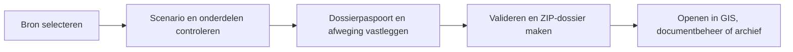

# Verantwoordingsdocument

**Gilde:** Iteratie 4/5 - Afgeronde deep-dive<br>
**Student:** Hugo de Heus<br>
**Studentnummer:** 1852688<br>
**Project:** Dossiervorming Digitale Scenario's vanuit Digital Twin<br>
**Opdrachtgever:** Provincie Utrecht<br>
**Documentstatus:** Deep-dive afgerond met onderzoeksresultaten en eindadvies

**Datum:** 28 oktober 2026

## Inhoudsopgave

* [1. Inleiding](#1-inleiding)
    * [1.1 Leeswijzer](#11-leeswijzer)
    * [1.2 Versiebeheer](#12-versiebeheer)
    * [1.3 Begrippenlijst](#13-begrippenlijst)
* [2. Projectoriëntatie](#2-projectoriëntatie)
    * [2.1 Organisatorische context en situatie](#21-organisatorische-context-en-situatie)
    * [2.2 Van situatie naar probleem](#22-van-situatie-naar-probleem)
    * [2.3 Gewenste oplossing](#23-gewenste-oplossing)
    * [2.4 Productdoel en afbakening](#24-productdoel-en-afbakening)
    * [2.5 Team, rollen en stakeholders](#25-team-rollen-en-stakeholders)
    * [2.6 Relatie met SDG 3: Goede gezondheid en welzijn](#26-relatie-met-sdg-3-goede-gezondheid-en-welzijn)
* [3. Verantwoording van gemaakte keuzes met MCDA](#3-verantwoording-van-gemaakte-keuzes-met-mcda)
    * [3.1 Werkwijze en rekenregel](#31-werkwijze-en-rekenregel)
    * [3.2 Stakeholderbelangen achter de gewichten](#32-stakeholderbelangen-achter-de-gewichten)
    * [3.3 MCDA 1 - Extract, Transform, Load-technologie](#33-mcda-1---extract-transform-load-technologie)
    * [3.4 MCDA 2 - Primair dossierformaat](#34-mcda-2---primair-dossierformaat)
    * [3.5 MCDA 3 - Basiskaart voor de ruimtelijke controle](#35-mcda-3---basiskaart-voor-de-ruimtelijke-controle)
    * [3.6 Nadelen, onverwachte uitkomst en verantwoordelijkheid](#36-nadelen-onverwachte-uitkomst-en-verantwoordelijkheid)
    * [3.7 Mitigatie en besluitstatus](#37-mitigatie-en-besluitstatus)
* [4. Verantwoording van opgeleverd werk](#4-verantwoording-van-opgeleverd-werk)
    * [4.1 Criteria voor de beroepsproducten](#41-criteria-voor-de-beroepsproducten)
    * [4.2 Toepassing van curriculumkennis](#42-toepassing-van-curriculumkennis)
    * [4.3 Bewijs en actuele status](#43-bewijs-en-actuele-status)
* [5. Deep-dive: een duurzaam en controleerbaar GIS-dossier](#5-deep-dive-een-duurzaam-en-controleerbaar-gis-dossier)
    * [5.1 Hoofdvraag en antwoord](#51-hoofdvraag-en-antwoord)
    * [5.2 Context, afbakening en bewijs](#52-context-afbakening-en-bewijs)
    * [5.3 Methode en meetlat](#53-methode-en-meetlat)
    * [5.4 Resultaten van de formaatvergelijking](#54-resultaten-van-de-formaatvergelijking)
    * [5.5 Resultaten van validatie en integriteitsproeven](#55-resultaten-van-validatie-en-integriteitsproeven)
    * [5.6 Onafhankelijke leesproef, bronnen en betrouwbaarheid](#56-onafhankelijke-leesproef-bronnen-en-betrouwbaarheid)
    * [5.7 Eindadvies en antwoord op de deelvragen](#57-eindadvies-en-antwoord-op-de-deelvragen)
    * [5.8 Afronding, reflectie en presentatie](#58-afronding-reflectie-en-presentatie)
* [6. Peerreview en voorbereiding op gilde 2 en 3](#6-peerreview-en-voorbereiding-op-gilde-2-en-3)
    * [6.1 Reviewplanning en status](#61-reviewplanning-en-status)
    * [6.2 Ontvangen feedback en verwerking](#62-ontvangen-feedback-en-verwerking)
        * [Reviewer 1 - Noa Dronkers](#reviewer-1---noa-dronkers)
        * [Reviewer 2 - Jasper van Es](#reviewer-2---jasper-van-es)
        * [Docentobservaties](#docentobservaties)
    * [6.3 Tweede feedbackronde](#63-tweede-feedbackronde)
        * [Reviewer 3 - Sabrina Wor](#reviewer-3---sabrina-wor)
        * [Reviewer 4 - Tjibbe van Ommeren](#reviewer-4---tjibbe-van-ommeren)
    * [6.4 Omgaan met tegengestelde feedback](#64-omgaan-met-tegengestelde-feedback)
    * [6.5 Inbreng voor de discussie](#65-inbreng-voor-de-discussie)
    * [6.6 Gewenst professioneel gedrag](#66-gewenst-professioneel-gedrag)
* [7. Eindstatus en overdracht](#7-eindstatus-en-overdracht)
* [8. Bronnen en betrouwbaarheid](#8-bronnen-en-betrouwbaarheid)
* [9. Bewijsregister binnen dit document](#9-bewijsregister-binnen-dit-document)

<!-- TOC -->

## 1. Inleiding

Dit verantwoordingsdocument beschrijft hoe ik de opdracht van de Provincie Utrecht heb geïnterpreteerd, welke oplossing
ik voorstel en op basis van welke criteria ik de eerste technische keuzes heb gemaakt. Het document is zelfstandig
leesbaar. De relevante opdrachtcontext, ontwerpkeuzes, procesbeschrijving, testresultaten en bewijsverwijzingen zijn
daarom in dit document zelf opgenomen.

Voor de tweede en derde gildesessie ligt de nadruk op het herleidbaar verantwoorden van keuzes. Ik gebruik daarvoor
Multi-Criteria Decision Analysis (MCDA): alternatieven worden aan dezelfde criteria getoetst, criteria krijgen een
gemotiveerd gewicht en scores worden gekoppeld aan bronnen, projectevidence en stakeholderbelangen. Daarnaast leg ik
mijn deep-divekeuze voor iteratie 4 of 5 vast.

### 1.1 Leeswijzer

- Hoofdstuk 2 beschrijft de projectoriëntatie.
- Hoofdstuk 3 verantwoordt drie belangrijke keuzes met MCDA.
- Hoofdstuk 4 koppelt het opgeleverde werk aan toetsbare criteria.
- Hoofdstuk 5 bevat de afgeronde deep-dive met meetresultaten, beperkingen en eindadvies.
- Hoofdstuk 6 bevat het peerreviewproces en de verwerking van feedback.
- Hoofdstuk 8 maakt de gebruikte informatie herleidbaar.

### 1.2 Versiebeheer

| Versie | Datum      | Iteratie | Wijziging                                                                                                                                                       |
|--------|------------|----------|-----------------------------------------------------------------------------------------------------------------------------------------------------------------|
| 0.1    | 21-09-2026 | Gilde 1  | Eerste versie met projectoriëntatie, SDG-koppeling, keuzeverantwoording, beroepsproducten, deep-dive en actuele kwaliteitsbevinding                             |
| 0.2    | 21-09-2026 | Gilde 2  | Gewogen MCDA voor ETL, dossierformaten en basiskaart. Stakeholderconflicten, gevoeligheidsanalyse, bronnenregister, deep-diveplan en reviewformulier toegevoegd |
| 0.3    | 06-10-2026 | Gilde 2  | Feedback van Noa Dronkers en Jasper van Es verwerkt en de deep-dive verder afgebakend                                                                           |
| 0.4    | 06-10-2026 | Gilde 2  | Docentfeedback verwerkt door scoreherleidbaarheid toe te voegen en een direct leesbare PDF als inlevervorm te kiezen                                            |
| 0.5    | 06-10-2026 | Gilde 3  | Feedback van Sabrina Wor en Tjibbe van Ommeren geregistreerd                                                                                                    |
| 0.6    | 27-10-2026 | Gilde 3  | Tweede feedbackronde verwerkt in de MCDA-onderbouwing, bronverwijzingen, begripsuitleg en deep-diveopzet                                                        |
| 0.7    | 27-10-2026 | Gilde 4  | Deep-dive uitgewerkt met onderzoeksmethode, bronnenstrategie, urenplanning, relevantie, toetsbare resultaten en presentatieplan                                 |
| 0.8 | 28-10-2026 | Gilde 4/5 | Deep-dive afgerond met drie proefpakketten, 90 meetruns, zes integriteitsproeven, GDAL-leesproef en eindadvies |

Het project zelf gebruikt Git. De repository bevat commits vanaf 7 september 2026. Dit document wordt vanaf deze versie
meegeleverd als projectbewijs.

### 1.3 Begrippenlijst

| Begrip  | Betekenis binnen dit project                                                                 |
|---------|----------------------------------------------------------------------------------------------|
| API     | Technische koppeling waarmee de applicatie gegevens uit Tygron opvraagt                      |
| CRS     | Coördinatenreferentiesysteem dat bepaalt hoe geografische coördinaten worden geïnterpreteerd |
| DMS     | Documentmanagementsysteem voor het beheren en terugvinden van documenten en dossiers         |
| ETL     | Extract, Transform, Load. Het ophalen, omzetten en opslaan van gegevens                      |
| FME     | Commerciële software voor het transformeren en uitwisselen van data, waaronder GIS-data      |
| GIS     | Geografisch informatiesysteem voor het beheren, analyseren en tonen van ruimtelijke gegevens |
| MCDA    | Methode om alternatieven met meerdere gewogen criteria te vergelijken                        |
| OGC     | Internationale organisatie die open standaarden voor geografische informatie beheert         |
| SHA-256 | Hashfunctie waarmee kan worden gecontroleerd of een bestand na export is gewijzigd           |

## 2. Projectoriëntatie

### 2.1 Organisatorische context en situatie

De Provincie Utrecht ondersteunt gemeenten bij gebiedsontwikkeling. Hiervoor wordt de Digital Twin-omgeving van Tygron
gebruikt. In Tygron kunnen scenario's worden doorgerekend en beoordeeld met onder andere kaartlagen, indicatoren,
maatregelen en meldingen. De interactieve omgeving is bruikbaar tijdens een actief project en vereist een licentie.

De informatie heeft ook na beëindiging van een Tygron-project waarde. Beleidsmedewerkers, specialisten in geografische
informatiesystemen (GIS-specialisten),
informatiebeheerders en betrokken gemeenten moeten later kunnen reconstrueren:

- Welk scenario is beoordeeld.
- Welke resultaten en kaartobjecten daarbij hoorden.
- Welke onderdelen uiteindelijk zijn geselecteerd.
- Welke afwegingen en besluitcontext zijn vastgelegd.
- Of het overgedragen dossier na export nog compleet en ongewijzigd is.

Deze opdrachtomschrijving vormt het uitgangspunt voor de probleemanalyse, de ontwerpkeuzes en de beoordeling van het
prototype in de volgende hoofdstukken.

### 2.2 Van situatie naar probleem

De Tygron 3D-viewer is gekoppeld aan een actief Tygron-project. Wanneer het project niet meer actief of toegankelijk is,
is deze viewer geen onafhankelijke archiefvoorziening. Alleen een schermafbeelding of een losse data-export is ook
onvoldoende, daarmee ontbreken: structuur, samenhang, besluitcontext en een controle op volledigheid.

Het kernprobleem is daarom:

> Hoe kan de Provincie Utrecht de relevante inhoud en gemaakte afwegingen van een Tygron-scenario duurzaam,
> controleerbaar en GIS-geschikt bewaren, zodat deze informatie ook zonder actieve Tygron-omgeving geraadpleegd kan
> worden?

Het probleem bestaat uit vijf deelproblemen:

1. De gebruiker moet het juiste project en scenario kunnen selecteren.
2. Tygron-componenten moeten worden opgehaald en getransformeerd.
3. Ruimtelijke en niet-ruimtelijke gegevens moeten duurzaam worden verpakt.
4. Keuzes en metadata moeten naast technische data worden vastgelegd.
5. Het dossier moet later zonder Tygron gecontroleerd en geopend kunnen worden.

### 2.3 Gewenste oplossing

Mijn productvisie is een taakgerichte webapplicatie waarmee een gebruiker in drie herkenbare stappen een zelfstandig
scenariodossier maakt:



De gebruiker begint met het kiezen van een gegevensbron en controleert daarna welk scenario en welke onderdelen relevant
zijn. Vervolgens legt de gebruiker de dossiercontext en gemaakte afweging vast. De applicatie valideert de geselecteerde
gegevens, maakt het ZIP-dossier en biedt dit aan voor gebruik in GIS-software of overdracht naar een beheerde
archiefvoorziening. De technische export ondersteunt het proces, maar vervangt niet de inhoudelijke beoordeling of de
formele opname in een documentmanagementsysteem (DMS) of e-depot.

Het beoogde dossier bevat open en breed ondersteunde formaten: GeoPackage, GeoJSON, CSV, JSON, optioneel GeoTIFF en een
zelfstandig HTML-rapport. Metadata, een validatierapport en hashes volgens het Secure Hash Algorithm 256-bit (SHA-256)
maken de overdracht controleerbaar.

### 2.4 Productdoel en afbakening

Het productdoel voor het prototype is:

> Een gebruiker kan een demo, actieve Tygron-sessie of startbaar Tygron-project selecteren, de relevante onderdelen
> controleren, een onderbouwde selectie maken en een zelfstandig GIS-dossier downloaden en opnieuw valideren.

Binnen de huidige scope vallen:

- Selectie van project, scenario en individuele onderdelen.
- Verwerking van overlays, indicatoren, measures en alerts.
- Een ruimtelijke 2D-preview.
- Export naar open GIS- en tabelformaten.
- Dossiermetadata, besluitonderbouwing en een leesbaar rapport.
- Technische validatie en integriteitscontrole.
- Een werkinstructie voor QGIS en ArcGIS Pro.

Buiten de scope van het prototype vallen:

- Reconstructie van de volledige interactieve Tygron 3D-scene.
- Formele opname in een provinciaal DMS of e-depot.
- Een definitief autorisatie- en bewaarbeleid.
- Inhoudelijke garantie dat een scenario of besluit beleidsmatig juist is.
- Volledige ondersteuning van ieder projectspecifiek Tygron objecttype.

### 2.5 Team, rollen en stakeholders

Ik werk als student aan het ontwerp, de implementatie, de tests en de documentatie van het prototype. Binnen het project
vervul ik daardoor voorlopig meerdere rollen: informatieanalist, ontwerper, Python-ontwikkelaar, GIS-ontwikkelaar en
tester.

De voorlopige stakeholderanalyse is:

| Stakeholder                      | Belang                                                     | Betrokkenheid bij validatie                                                  |
|----------------------------------|------------------------------------------------------------|------------------------------------------------------------------------------|
| Provincie Utrecht, opdrachtgever | Duurzame beschikbaarheid en overdraagbaarheid              | Eisen, prioriteiten en acceptatie bevestigen                                 |
| GIS-specialisten                 | Correcte geometrie en bruikbaarheid in QGIS/ArcGIS         | GeoPackage, GeoJSON, coördinatenreferentiesysteem (CRS) en symbologie testen |
| Informatiebeheer en archief      | Context, integriteit, bewaartermijn en dossiervorming      | Dossierschema en metadata beoordelen                                         |
| Gemeenten en projectteams        | Resultaten en keuzes later begrijpelijk raadplegen         | Gebruiksgemak en rapport beoordelen                                          |
| Tygron-beheerder                 | Veilige en juiste toegang tot projectdata                  | API-route en sessiegedrag controleren                                        |
| Docent en medestudenten          | Kwaliteit van verantwoording en professionele ontwikkeling | Gilde-observaties en peerreviews                                             |

Deze rollen zijn een eerste analyse. Formeel eigenaarschap, gebruik en acceptatie zijn binnen dit onderzoek niet
bevestigd. Dit beperkt de organisatorische geldigheid van het eindadvies.

### 2.6 Relatie met SDG 3: Goede gezondheid en welzijn

De opdracht noemt SDG 3. De relatie zit niet alleen in de techniek, maar vooral in de inhoud die met het dossier
behouden kan blijven. In gebiedsontwikkeling kunnen scenario's bijvoorbeeld hittestress, bereikbaarheid van groen,
actieve mobiliteit, geluid, luchtkwaliteit en zorgvoorzieningen bevatten.

Mijn ontwerpkeuzes ondersteunen SDG 3 als volgt:

- Gezondheidsindicatoren blijven na afloop van de Tygron-sessie raadpleegbaar.
- Maatregelen en indicatorwaarden worden samen met de scenario en besluitcontext bewaard.
- Verschillende scenario's kunnen later inhoudelijk worden vergeleken op een werkkopie.
- Open GIS-formaten maken hergebruik door andere professionals mogelijk.
- Een manifest helpt aantonen dat de onderliggende bestanden sinds overdracht niet ongemerkt zijn gewijzigd.

De applicatie bewijst zelf geen gezondheidseffect. De betekenis van een indicator, bronkwaliteit en beleidsmatige
interpretatie blijven de verantwoordelijkheid van domeinexperts. Welke gezondheidsindicatoren minimaal in een formeel
dossier horen is binnen deze deep-dive niet vastgesteld. Het onderzoek toont geen gezondheidseffect aan.

## 3. Verantwoording van gemaakte keuzes met MCDA

### 3.1 Werkwijze en rekenregel

MCDA is hier beslisondersteuning en geen automatische waarheid. Ik heb per beslissing eerst de alternatieven afgebakend,
daarna criteria en gewichten bepaald, ieder alternatief op een schaal van 1 tot en met 5 beoordeeld en tenslotte de
uitkomst geïnterpreteerd. De aanpak sluit aan bij de stappen uit
de [MCDA-handleiding van de Britse overheid](https://www.gov.uk/government/publications/multi-criteria-analysis-manual-for-making-government-policy).

De gewichten tellen per MCDA op tot 100%. De gewogen totaalscore loopt van 0 tot 100 en wordt als volgt berekend:

```text
gewogen totaalscore = som(gewicht × score / 5)
```

De scores betekenen:

| Score | Betekenis                                         |
|------:|---------------------------------------------------|
|     1 | Voldoet nauwelijks of brengt een groot risico mee |
|     2 | Voldoet beperkt                                   |
|     3 | Voldoet voldoende, maar met duidelijke nadelen    |
|     4 | Voldoet goed                                      |
|     5 | Voldoet zeer goed en is met bewijs onderbouwd     |

De cijfers zijn gebaseerd op de opdracht, officiële standaarden en documentatie, projectbewijs en mijn voorlopige
stakeholderanalyse. Waar nog geen stakeholderbevestiging bestaat, benoem ik dit als aanname. Daarmee voorkom ik dat een
exact getal meer zekerheid suggereert dan de beschikbare informatie toelaat.

### 3.2 Stakeholderbelangen achter de gewichten

De criteria zijn niet neutraal: stakeholders leggen verschillende accenten.

| Stakeholder                       | Zwaarwegend belang                                   | Mogelijk conflict                                                                   |
|-----------------------------------|------------------------------------------------------|-------------------------------------------------------------------------------------|
| Beleidsmedewerker of gemeente     | Eenvoudig selecteren en later begrijpen              | Wil weinig technische stappen, terwijl dossiervorming extra metadata vraagt         |
| GIS-specialist                    | Correcte geometrie en brede GIS-ondersteuning        | Kan rijkere formaten verkiezen die voor niet-GIS-gebruikers minder transparant zijn |
| Informatiebeheerder of archivaris | Openheid, context, integriteit en bewaarbeleid       | Duurzaamheid kan extra werk en strengere invoer vragen                              |
| Provinciaal IT-beheer             | Security, beheerbaarheid en ondersteunde technologie | Centrale beheersbaarheid kan botsen met snelle lokale prototyping                   |
| Projectteam en student            | Snel een aantoonbaar prototype opleveren             | Korte doorlooptijd mag productie-eisen niet onzichtbaar maken                       |

Bij de formaatkeuze wegen duurzame toegankelijkheid en GIS-interoperabiliteit daarom samen 55%. Bij de ETL-keuze weegt
technische GIS-capaciteit zwaar, maar krijgen licentie-onafhankelijkheid, beheerbaarheid en testbaarheid samen meer
gewicht. Bij de kaartkeuze wegen privacy en offline beschikbaarheid samen 50%, omdat scenario-informatie niet
afhankelijk moet worden van een publieke kaartdienst.

Bij conflicterende belangen gebruik ik eerst harde randvoorwaarden. Security, wettelijke eisen en aantoonbare
integriteit mogen niet worden ingeruild voor gebruiksgemak. Daarna gebruik ik de gewogen MCDA om de resterende belangen
zichtbaar te vergelijken. Ik leg afwijkende belangen en aannames vast en geef een onderbouwd advies. De opdrachtgever
neemt het definitieve productbesluit na toetsing door de relevante gebruiker, GIS-specialist, informatiebeheerder en
IT-beheerder. Wanneer die toetsing nog niet heeft plaatsgevonden, blijft de keuze voor productie voorlopig.

### 3.3 MCDA 1 - Extract, Transform, Load-technologie

**Beslissing:** waarmee worden extractie, transformatie, validatie en verpakking gerealiseerd?

Extract, Transform, Load (ETL) is het proces waarin brongegevens worden opgehaald, omgezet en in een bruikbare
doelstructuur worden opgeslagen. FME is commerciële ETL-software voor onder andere geografische data. Python is een
programmeertaal waarmee dezelfde keten als eigen, testbare software kan worden gebouwd.

**Belangen bij deze keuze.** GIS-specialisten hebben belang bij krachtige transformaties, terwijl IT-beheer vooral let
op onderhoud, security en aansluiting op ondersteunde technologie. Voor het prototype weegt daarnaast mee dat ik de
werking zonder aanvullende licentie moet kunnen demonstreren. Daarom zijn GIS-capaciteit, onafhankelijkheid,
beheerbaarheid en testbaarheid als afzonderlijke criteria opgenomen.

| Criterium                                         | Gewicht | Motivering                                                                         |
|---------------------------------------------------|--------:|------------------------------------------------------------------------------------|
| GIS- en transformatiecapaciteit                   |     25% | De kernopdracht vereist verwerking van ruimtelijke en niet-ruimtelijke Tygron-data |
| Licentie-onafhankelijkheid en reproduceerbaarheid |     20% | Het prototype moet overdraagbaar en zonder extra licentie demonstreerbaar zijn     |
| Beheerbaarheid voor de organisatie                |     20% | De oplossing moet na studentoverdracht begrepen en onderhouden kunnen worden       |
| Ontwikkelsnelheid binnen het prototype            |     15% | Binnen de onderwijsiteraties moet een werkende keten aantoonbaar zijn              |
| Testbaarheid en controleerbaarheid                |     15% | Fouten in een archiefexport moeten automatisch ontdekt kunnen worden               |
| Security en secretbeheer                          |      5% | Tygron-tokens mogen niet onnodig worden opgeslagen of verspreid                    |

| Alternatief              | GIS 25% | Onafhankelijk 20% | Ontwikkelsnelheid 15% | Beheer 20% | Testbaar 15% | Security 5% | Gewogen totaal |
|--------------------------|--------:|------------------:|----------------------:|-----------:|-------------:|------------:|---------------:|
| Python met open broncode |       4 |                 5 |                     5 |          3 |            5 |           4 |         **86** |
| FME-workspace            |       5 |                 2 |                     4 |          5 |            4 |           4 |         **81** |
| Hybride Python en FME    |       5 |                 3 |                     2 |          4 |            5 |           4 |         **78** |

**Herleidbaarheid per criterium.** De tabel hieronder maakt zichtbaar welke bron, projectbevinding en aanname achter
iedere kolom van de MCDA staat. De bronnen bevestigen producteigenschappen. De uiteindelijke score is mijn beoordeling
van die eigenschappen tegen de eisen van dit prototype.

| Criterium                                         | Bron of projectbewijs                                                                                                                                                                                                                                                                  | Onderbouwing van de scores                                                                                                                                                                                                                                                 |
|---------------------------------------------------|----------------------------------------------------------------------------------------------------------------------------------------------------------------------------------------------------------------------------------------------------------------------------------------|----------------------------------------------------------------------------------------------------------------------------------------------------------------------------------------------------------------------------------------------------------------------------|
| GIS- en transformatiecapaciteit                   | De [FME-lijst met readers en writers](https://docs.safe.com/fme/2024.2/html/FME-Form-Documentation/FME-ReadersWriters/Format-List-All.htm) toont ondersteuning voor veel GIS-formaten. De Python-route heeft een werkende projectexport, maar bevatte eerder een GeoPackage-regressie. | FME en hybride krijgen 5 door de brede ingebouwde GIS-ondersteuning. Python krijgt 4 omdat de benodigde functies werken, maar meer eigen implementatie en controle vragen.                                                                                                 |
| Licentie-onafhankelijkheid en reproduceerbaarheid | De [Python Software Foundation](https://www.python.org/about/) beschrijft Python als open source en vrij bruikbaar. Voor FME gelden de [licentievoorwaarden van Safe Software](https://www.safe.com/legal/).                                                                           | Python krijgt 5. FME krijgt 2 door de vereiste commerciële licentie. Hybride krijgt 3 omdat een deel zonder FME kan draaien, maar de volledige keten licentieafhankelijk blijft.                                                                                           |
| Ontwikkelsnelheid binnen het prototype            | De score gaat over de tijd om in dit project een aantoonbare keten te bouwen, niet over uitvoersnelheid. De bestaande Python-code en tests zijn projectevidence. Voor de hybride route bestaat nog geen proefimplementatie.                                                            | Python krijgt 5 omdat de keten al werkend is. FME krijgt 4 omdat veel transformaties visueel beschikbaar zijn. Hybride krijgt 2 door twee runtimes en een extra overdrachtsgrens. Dit blijft een projectinschatting zolang geen tijdmeting van alle alternatieven bestaat. |
| Beheerbaarheid voor de organisatie                | FME biedt een visuele workspace. Python-code is in Git vast te leggen en te reviewen. Er is nog geen validatie door provinciaal IT-beheer.                                                                                                                                             | FME krijgt voorlopig 5, hybride 4 en Python 3. Deze scores kunnen veranderen zodra IT-beheer aangeeft welke technologie structureel wordt ondersteund.                                                                                                                     |
| Testbaarheid en controleerbaarheid                | De officiële [Python-documentatie over unittest](https://docs.python.org/3/library/unittest.html) beschrijft testautomatisering. De projecttests leveren direct bewijs voor de Python-route.                                                                                           | Python en hybride krijgen 5 doordat geautomatiseerde tests rechtstreeks onderdeel van de code kunnen zijn. FME krijgt 4 omdat testen mogelijk is, maar in dit prototype nog niet is aangetoond.                                                                            |
| Security en secretbeheer                          | In alle routes kunnen tokens tijdelijk worden verwerkt. De huidige applicatie slaat het Tygron-token niet in het dossier op. Er is nog geen onafhankelijke securityreview.                                                                                                             | Alle alternatieven krijgen 4. Een score van 5 is niet verantwoord zonder securityreview en controle van logging en configuratie.                                                                                                                                           |

De bronnen onderbouwen producteigenschappen en projectbevindingen. De vertaling daarvan naar een score blijft mijn
beargumenteerde beoordeling en is dus geen rechtstreeks door de bron gegeven cijfer.

**Analyse.** FME scoort sterk op GIS-transformaties en visueel beheer. De officiële FME-documentatie toont brede
reader/writer-ondersteuning, maar FME is software waarvoor licentievoorwaarden gelden. Python is in dit
prototype volledig in Git vast te leggen, zonder FME-runtime uit te voeren en rechtstreeks met geautomatiseerde tests te
controleren. Daar staat tegenover dat handmatige GIS-implementatie specialistischer en foutgevoeliger is.

**Conclusie en advies.** Voor het prototype kies ik Python. Voor productie adviseer ik geen automatische voortzetting
van die keuze: laat provinciaal GIS- en IT-beheer beoordelen of een FME-adapter of een door de Geospatial Data
Abstraction Library (GDAL) ondersteunde
Python-implementatie beter aansluit op het beheerlandschap.

**Gevoeligheid.** Als beheerbaarheid voor de Provincie zwaarder wordt dan licentie-onafhankelijkheid en snelle
prototyping, kan FME de voorkeursoptie worden. De uitkomst is dus afhankelijk van de nog te valideren beheerstrategie.

### 3.4 MCDA 2 - Primair dossierformaat

**Beslissing:** in welke vorm worden ruimtelijke en niet-ruimtelijke scenarioresultaten duurzaam overgedragen?

**Belangen bij deze keuze.** GIS-specialisten hebben een volledig bruikbaar ruimtelijk formaat nodig.
Informatiebeheerders hebben daarnaast behoefte aan openheid, context, integriteitscontrole en herstelbaarheid.
Beleidsmedewerkers en gemeenten moeten de kern ook zonder specialistische GIS-kennis kunnen begrijpen. Daarom combineert
de beoordeling GIS-interoperabiliteit met duurzame toegankelijkheid en transparantie.

Het [Nationaal Archief](https://www.nationaalarchief.nl/archiveren/kennisbank/geo-data) noemt GPKG en GeoJSON
voorkeursformaten voor geodata en File Geodatabase acceptabel. Het
[Open Geospatial Consortium (OGC)](https://www.geopackage.org/) beschrijft
GeoPackage als een open, platformonafhankelijk, draagbaar en zelfbeschrijvend SQLite-formaat voor vectorgegevens, tiles
en attributen. Deze bronnen wegen zwaar omdat de opdrachtgever een Nederlandse overheidsorganisatie is en OGC de
normatieve standaard beheert.

Een GeoPackage is één bestand met de extensie `.gpkg`. Binnen dat bestand staat een SQLite-database met vaste
standaardtabellen voor onder andere kaartlagen, geometrie, coördinatenstelsels, attributen en metadata. Een gebruiker
kan
het bestand rechtstreeks openen in GIS-software. Daardoor is het geen map met losse onderdelen zoals een File
Geodatabase en ook geen verzameling tekstbestanden zoals een combinatie van GeoJSON en CSV.

| Criterium                              | Gewicht | Motivering                                                                     |
|----------------------------------------|--------:|--------------------------------------------------------------------------------|
| Duurzame toegankelijkheid              |     30% | Onafhankelijke raadpleegbaarheid na beëindiging van Tygron is het kernprobleem |
| GIS-interoperabiliteit                 |     25% | QGIS en Esri-producten zijn expliciet onderdeel van de opdracht                |
| Ruimtelijke én niet-ruimtelijke inhoud |     15% | Eén scenario bevat geometrie, indicatoren, waarschuwingen en context           |
| Draagbaarheid                          |     10% | Een beperkt aantal samenhangende bestanden verkleint overdrachtsfouten         |
| Transparantie en herstelbaarheid       |     10% | Brondata moet ook buiten een applicatie inspecteerbaar blijven                 |
| Implementatie-inspanning               |     10% | De keuze moet binnen het prototype uitvoerbaar zijn                            |

| Alternatief                                  | Duurzaam 30% | GIS 25% | Gemengde data 15% | Draagbaar 10% | Transparant 10% | Inspanning 10% | Gewogen totaal |
|----------------------------------------------|-------------:|--------:|------------------:|--------------:|----------------:|---------------:|---------------:|
| GeoPackage met JSON/CSV/GeoJSON als formaten |            5 |       5 |                 5 |             5 |               4 |              4 |         **96** |
| Alleen GeoJSON en CSV                        |            5 |       4 |                 3 |             2 |               5 |              5 |         **83** |
| GML met JSON/CSV                             |            5 |       4 |                 4 |             2 |               4 |              2 |         **78** |
| Esri File Geodatabase                        |            3 |       5 |                 5 |             3 |               2 |              3 |         **74** |

**Herleidbaarheid per criterium.** De onderstaande tabel onderbouwt iedere criteriumkolom afzonderlijk. De numerieke
scores blijven een beargumenteerde vergelijking. De bronnen leveren de controleerbare eigenschappen waarop die
vergelijking is gebaseerd.

| Criterium                              | Bron of projectbewijs                                                                                                                                                                                                                                                                                                                                                                                | Onderbouwing van de scores                                                                                                                                                                                                                                                    |
|----------------------------------------|------------------------------------------------------------------------------------------------------------------------------------------------------------------------------------------------------------------------------------------------------------------------------------------------------------------------------------------------------------------------------------------------------|-------------------------------------------------------------------------------------------------------------------------------------------------------------------------------------------------------------------------------------------------------------------------------|
| Duurzame toegankelijkheid              | Het [Nationaal Archief](https://www.nationaalarchief.nl/archiveren/kennisbank/geo-data) geeft GPKG, GeoJSON en GML de status voorkeur en File Geodatabase de status acceptabel.                                                                                                                                                                                                                      | GeoPackage met aanvullende formaten, GeoJSON met CSV en GML met JSON en CSV krijgen 5. File Geodatabase krijgt 3 omdat het wel acceptabel is, maar niet als voorkeursformaat is aangewezen.                                                                                   |
| GIS-interoperabiliteit                 | De [OGC GeoPackage-specificatie](https://docs.ogc.org/is/12-128r19/12-128r19.html) definieert een open standaard. [ArcGIS Pro](https://pro.arcgis.com/en/pro-app/latest/help/projects/connect-to-a-database.htm) kan GeoPackage openen en maken. De [GDAL-driverlijst](https://gdal.org/en/stable/drivers/vector/index.html) toont lees- en schrijfondersteuning voor GPKG, GeoJSON, GML en FileGDB. | GeoPackage en File Geodatabase krijgen 5. GeoJSON en GML krijgen 4 omdat ze breed uitwisselbaar zijn, maar in deze dossieropzet aanvullende bestanden nodig hebben voor alle niet-ruimtelijke inhoud. Praktijktests in de beheerde QGIS- en ArcGIS Pro-versies blijven nodig. |
| Ruimtelijke en niet-ruimtelijke inhoud | De OGC-specificatie beschrijft vectorfeatures en niet-ruimtelijke attributentabellen in dezelfde container. ArcGIS Pro ondersteunt zowel GeoPackage als File Geodatabase. De andere opties verdelen de inhoud over ruimtelijke en tabelbestanden.                                                                                                                                                    | GeoPackage en File Geodatabase krijgen 5. GML met JSON en CSV krijgt 4. GeoJSON met CSV krijgt 3 doordat relaties en context over losse bestanden worden verdeeld.                                                                                                            |
| Draagbaarheid                          | De OGC-specificatie beschrijft GeoPackage als een zelfbeschrijvend enkel bestand. GeoJSON met CSV en GML met JSON en CSV bestaan uit meerdere bestanden. Een File Geodatabase is een mapstructuur die als geheel moet worden overgedragen.                                                                                                                                                           | GeoPackage krijgt 5. File Geodatabase krijgt 3. De combinaties met losse tekstbestanden krijgen 2 door het grotere risico op ontbrekende of gescheiden onderdelen.                                                                                                            |
| Transparantie en herstelbaarheid       | JSON, CSV, GeoJSON en GML zijn tekstueel inspecteerbaar. GeoPackage gebruikt een binaire SQLite-structuur, maar heeft een openbare specificatie en kan met standaard SQLite- en GIS-tools worden onderzocht.                                                                                                                                                                                         | De tekstformaten krijgen 5 of 4. GeoPackage met aanvullende tekstformaten krijgt 4. File Geodatabase krijgt 2 doordat inspectie sterker van leverancierssoftware en specifieke drivers afhangt.                                                                               |
| Implementatie-inspanning               | De prototype-export maakt al GeoPackage, JSON, CSV en GeoJSON. Voor GML bestaat nog geen werkende export. De [GDAL GeoPackage-driver](https://gdal.org/en/stable/drivers/vector/gpkg.html) ondersteunt aanmaken, lezen, schrijven en valideren.                                                                                                                                                      | GeoJSON met CSV krijgt 5 en GeoPackage met aanvullende formaten 4. File Geodatabase krijgt 3. GML met aanvullende formaten krijgt 2 omdat hiervoor nog een extra export en validatieroute moeten worden gebouwd.                                                              |

Ook hier zijn de cijfers mijn interpretatie van bronnen, projectevidence en eisen. De bronnen zelf kennen geen
MCDA-score
toe.

**Afbakening van snelheid.** Uitvoersnelheid is niet als criterium opgenomen, omdat geen benchmark
met representatieve Tygron-data bestaat. De geïsoleerde demo-proef in paragraaf 5.4 is reproduceerbaar, maar meet geen productie-export. De [GDAL-documentatie](https://gdal.org/en/stable/drivers/vector/gpkg.html)
beschrijft ondersteuning voor een RTree ruimtelijke index en rechtstreekse SQLite-query's. Dat maakt snelle ruimtelijke
selectie technisch mogelijk, maar bewijst niet dat dit prototype sneller is dan de alternatieven. Voor een onderbouwde
prestatiescore moeten dezelfde datasets en bewerkingen per formaat worden gemeten. Tot die test is snelheid geen reden
voor de keuze van GeoPackage. De afgeronde demo-proef verandert deze afbakening niet.

**Analyse.** GeoPackage combineert features en gewone attributentabellen in een bestand. De bron-JSON en eenvoudige
formaten blijven nodig, omdat een genormaliseerd schema mogelijk niet alle Tygron-eigenschappen behoudt. De Library
of Congress beschrijft GeoPackage eveneens als platformonafhankelijk en gericht op interoperabiliteit, maar de binaire
SQLite-structuur is minder direct leesbaar dan tekstformaten. Het Nationaal Archief merkt bovendien op dat validatie van
GeoPackage niet breed wordt ondersteund. Daarom bevat het prototype een eigen structuurcontrole en moet voor productie
een officiële conformiteitstest worden overwogen.

Meerdere formaten hebben ook nadelen. Ze vragen extra opslag, vergroten het aantal te beheren bestanden en kunnen
onderling afwijken wanneer bestanden los worden gewijzigd. In het prototype worden alle representaties daarom tijdens
dezelfde export uit dezelfde geselecteerde brondata gemaakt. De aantallen worden automatisch vergeleken, de bron-JSON
blijft beschikbaar voor reconstructie en het SHA-256-manifest detecteert wijzigingen na export. Dit beperkt het risico,
maar maakt formeel versiebeheer en een aangewezen gezaghebbende representatie voor productie nog steeds noodzakelijk.

**Conclusie en advies.** Ik kies GeoPackage als primaire GIS-container, aangevuld met bron-JSON, CSV, GeoJSON en waar
beschikbaar GeoTIFF. Deze combinatie wint niet omdat ieder formaat afzonderlijk perfect is, maar omdat de formaten
elkaars zwakke punten afdekken.

**Gevoeligheid.** Wanneer menselijke leesbaarheid het enige criterium zou zijn, winnen JSON en CSV. Wanneer een
organisatie uitsluitend Esri gebruikt, stijgt File Geodatabase. Door de expliciete eis van duurzame,
software-onafhankelijke raadpleegbaarheid blijven open formaten noodzakelijk.

### 3.5 MCDA 3 - Basiskaart voor de ruimtelijke controle

**Beslissing:** hoe krijgt de gebruiker ruimtelijke context zonder de archieffunctie afhankelijk te maken van een
externe kaartdienst?

**Belangen bij deze keuze.** Gebruikers en GIS-specialisten willen herkenbare ruimtelijke context. Informatiebeheer en
IT-beheer willen voorkomen dat vertrouwelijke projectlocaties onnodig met derden worden gedeeld en dat een dossier later
afhankelijk blijkt van een verdwenen kaartdienst. Daarom wegen privacy en offline beschikbaarheid samen zwaarder dan
installatiegemak.

| Criterium                  | Gewicht | Motivering                                                           |
|----------------------------|--------:|----------------------------------------------------------------------|
| Privacy en datacontrole    |     25% | Projectlocaties mogen niet ongemerkt als requests naar derden gaan   |
| Offline beschikbaarheid    |     25% | De controle moet ook zonder publieke kaartdienst bruikbaar blijven   |
| Ruimtelijke herkenbaarheid |     20% | Een GIS-gebruiker moet maatregelen en alerts snel kunnen lokaliseren |
| Installatiegemak           |     15% | Een zware kaartstack verhoogt de demonstratie- en beheerdrempel      |
| Operationele kosten        |     15% | Hosting, opslag en onderhoud moeten proportioneel blijven            |

| Alternatief                               | Privacy 25% | Offline 25% | Context 20% | Installatie 15% | Kosten 15% | Gewogen totaal |
|-------------------------------------------|------------:|------------:|------------:|----------------:|-----------:|---------------:|
| Lokale OpenMapTiles met neutrale fallback |           5 |           5 |           5 |               3 |          3 |         **88** |
| Geen basiskaart, alleen scenario-objecten |           5 |           5 |           1 |               5 |          5 |         **84** |
| Publieke externe tegelservice             |           2 |           2 |           5 |               5 |          5 |         **70** |

**Herleidbaarheid per criterium.** Ook bij deze MCDA wordt de onderbouwing per criterium gegeven. Opslag, beheer en
kosten blijven voorlopig zolang geen productiegebied, zoomniveau en concrete leverancier zijn vastgesteld.

| Criterium                  | Bron of projectbewijs                                                                                                                                                                                                                                                                                                    | Onderbouwing van de scores                                                                                                                                                                                          |
|----------------------------|--------------------------------------------------------------------------------------------------------------------------------------------------------------------------------------------------------------------------------------------------------------------------------------------------------------------------|---------------------------------------------------------------------------------------------------------------------------------------------------------------------------------------------------------------------|
| Privacy en datacontrole    | De lokale proefopstelling levert kaarttegels zonder requests naar een externe kaartdienst. Bij een publieke tegelservice worden locatiegebonden tegelrequests naar de aanbieder gestuurd.                                                                                                                                | Lokaal en geen basiskaart krijgen 5. De publieke dienst krijgt 2 omdat het dataverkeer buiten de eigen omgeving plaatsvindt. De precieze privacy-impact hangt af van de gekozen leverancier en logging.             |
| Offline beschikbaarheid    | De [OpenMapTiles-handleiding](https://openmaptiles.org/docs/generate/generate-openmaptiles/) beschrijft het lokaal genereren van vectortegels. De [OpenStreetMap Tile Usage Policy](https://operations.osmfoundation.org/policies/tiles/) beschrijft de publieke dienst als best effort zonder beschikbaarheidsgarantie. | Lokaal en geen basiskaart krijgen 5. Een publieke externe dienst krijgt 2 door netwerkafhankelijkheid en het ontbreken van een gegarandeerd serviceniveau.                                                          |
| Ruimtelijke herkenbaarheid | De werkende preview toont dat een basiskaart wegen, water en plaatsen rond scenario-objecten zichtbaar maakt. Zonder basiskaart blijven alleen de objecten over.                                                                                                                                                         | Beide kaartalternatieven krijgen 5. Geen basiskaart krijgt 1. Deze gebruikerswaardering moet nog met eindgebruikers worden gevalideerd.                                                                             |
| Installatiegemak           | OpenMapTiles vraagt volgens de officiële handleiding Docker, kaartdata, vrije schijfruimte en geheugen. Geen basiskaart vraagt geen extra voorziening. Een publieke dienst vraagt vooral een URL en correcte attributie.                                                                                                 | Geen basiskaart en publiek krijgen 5. Lokaal krijgt 3 door de extra tileserver, data en configuratie.                                                                                                               |
| Operationele kosten        | Voor lokaal beheer zijn opslag, updates en monitoring nodig. De publieke OSM-tegeldienst kent gebruiksvoorwaarden, cachingseisen en geen beschikbaarheidsgarantie. Een commerciële leverancier is nog niet geselecteerd.                                                                                                 | Geen basiskaart en publiek krijgen voorlopig 5 op lokale beheerlast. Lokaal krijgt 3. De publieke score is geen uitspraak dat iedere externe dienst gratis is en moet bij leverancierskeuze opnieuw worden bepaald. |

De scores voor beheer en kosten zijn voorlopig zolang geen productiegebied en kaartleverancier zijn vastgesteld.

**Analyse.** Geen basiskaart is privacyvriendelijk en eenvoudig, maar maakt ruimtelijke controle lastig. Een publieke
service is gemakkelijk, maar introduceert netwerkafhankelijkheid en externe requests. Lokale OpenMapTiles kost opslag en
beheer, maar biedt de beste combinatie van context en controle. Door altijd een neutrale fallback te behouden, blokkeert
een defecte tileserver de dossierexport niet.

De lokale oplossing vereist naast de applicatie ook kaarttegels, een stijlconfiguratie en beheer van een tileserver.
De benodigde opslag groeit met het gekozen gebied en het aantal zoomniveaus en is daarom niet als vast getal te noemen.
Een externe kaartdienst vraagt minder lokale opslag en installatie, maar introduceert netwerkverkeer,
beschikbaarheidsrisico
en mogelijke gebruiksvoorwaarden. Voor productie moet IT-beheer deze operationele lasten meten voor het werkelijke
beheergebied voordat de definitieve kaartvoorziening wordt gekozen.

**Conclusie en advies.** Voor de demonstratie kies ik lokale OpenMapTiles met fallback. Voor productie moet IT-beheer
beslissen of lokaal gegenereerde tegels, een provinciale interne kaartservice of een andere beheerde voorziening het
beste past.

### 3.6 Nadelen, onverwachte uitkomst en verantwoordelijkheid

De MCDA rechtvaardigt geen blind vertrouwen in de gekozen implementatie. De Python-route heeft onder andere deze
nadelen:

- GIS-binaire formaten zelf schrijven is foutgevoeliger dan gebruik van GDAL of FME.
- Tygron-objectmodellen kunnen per type en project verschillen.
- Onderhoud komt bij de eigen codebasis te liggen.
- EPSG:4326 is niet voor iedere Nederlandse analyse optimaal.
- Een ZIP met hashes is geen formeel e-depot of digitale handtekening.
- Lokale OpenMapTiles vraagt merkbaar meer opslag en installatiebeheer.
- Meerdere uitvoerformaten vergroten opslag, beheer en het risico op onderlinge afwijkingen.
- Validatie kan vertragen wanneer stakeholders of externe leveranciers niet tijdig beschikbaar zijn.

Tijdens de controle voor versie 0.1 bleek de testsuite te falen met `sqlite3.OperationalError: no such table: overlays`.
De oorzaak is geen externe factor: in `create_geopackage()` staat het aanmaken van een componenttabel momenteel ten
onrechte binnen de `if spatial`-tak. Ik neem verantwoordelijkheid voor de conclusie dat de handmatige GeoPackage-route
onvoldoende beschermd was tegen regressie. Dit verandert niet direct de MCDA-winnaar, maar verlaagt mijn vertrouwen in
de implementatiescore en maakt aanvullende conformiteitstests noodzakelijk.

### 3.7 Mitigatie en besluitstatus

| Risico                       | Maatregel                                                                        | Status                               |
|------------------------------|----------------------------------------------------------------------------------|--------------------------------------|
| GeoPackage-regressie         | Tabelaanmaak herstellen, regressietest toevoegen en volledige suite groen maken  | Open                                 |
| Onvolledige normalisatie     | Bron-JSON en `source_json` naast afgeleide velden bewaren                        | Geïmplementeerd                      |
| Ongemerkt gewijzigd dossier  | SHA-256-manifest en onafhankelijke ZIP-controle                                  | Geïmplementeerd                      |
| Onjuiste GIS-interpretatie   | Praktijktest in beheerde QGIS- en ArcGIS Pro-versies                             | Open                                 |
| Onbevestigde beheerkeuze     | MCDA bespreken met GIS- en IT-beheer                                             | Open                                 |
| Ontbrekende archiefeisen     | Metadata en bewaarbeleid laten toetsen door informatiebeheer                     | Open                                 |
| Externe kaartafhankelijkheid | Lokale kaart plus neutrale fallback                                              | Geïmplementeerd                      |
| Afwijkende uitvoerformaten   | Alle formaten uit één bron genereren, aantallen vergelijken en hashes vastleggen | Deels geïmplementeerd                |
| Beheerlast lokale kaart      | Opslag, zoomniveaus en beheer voor het productiegebied laten meten               | Open                                 |
| Beperkte stakeholdertoegang  | Interviews vroeg plannen en besluiten als voorlopige aannames registreren        | Open                                 |
| Secrets in dossier of log    | Tokens alleen tijdelijk gebruiken en requestbody niet loggen                     | Geïmplementeerd, securityreview open |

De keuzes zijn voor het **prototype vastgesteld**, maar voor productie nog **voorlopig**. Reviewfeedback of nieuwe
stakeholdereisen kunnen de criteria, gewichten en uitkomst wijzigen. De technische uitwerking en de gevolgen van deze
keuzes worden in hoofdstuk 4 en hoofdstuk 5 van dit document toegelicht.

## 4. Verantwoording van opgeleverd werk

### 4.1 Criteria voor de beroepsproducten

Op basis van de opdracht hanteer ik de volgende criteria:

| Beroepsproduct     | Criterium                                                                             |
|--------------------|---------------------------------------------------------------------------------------|
| Selectie-interface | Een gebruiker kan bron, project, scenario en individuele onderdelen kiezen            |
| ETL-keten          | Overlays, indicatoren, measures en alerts worden gestructureerd verwerkt              |
| GIS-dossier        | De selectie wordt opgeslagen in GIS-geschikte en open formaten                        |
| Dossiercontext     | Afweging, eigenaar, besluitstatus, classificatie en bewaartermijn zijn vast te leggen |
| Validatie          | Structuur, aantallen en integriteit zijn technisch controleerbaar                     |
| Werkinstructie     | Gebruikers kunnen het dossier openen in QGIS en ArcGIS Pro                            |
| Demonstratie       | De volledige route is zonder betaald Tygron-account met demodata te tonen             |

### 4.2 Toepassing van curriculumkennis

In het project pas ik de volgende kennisgebieden toe:

- **Requirementsanalyse:** de opdracht is vertaald naar scope, stakeholders, functionele eisen en acceptatiecriteria.
- **Softwarearchitectuur:** bronextractie, selectie, export, validatie en presentatie zijn als afzonderlijke
  verantwoordelijkheden opgezet.
- **API-integratie:** de applicatie ondersteunt een actieve Tygron-sessie en het tijdelijk openen van een project via de
  root-API.
- **ETL en datamodellering:** bronrecords worden geselecteerd, genormaliseerd en naar meerdere doelvormen geschreven.
- **GIS:** geometrie, CRS, GeoJSON, GeoPackage, GeoTIFF en kaartvisualisatie worden toegepast.
- **Security en privacy:** secrets worden niet gearchiveerd of als requestbody gelogd. ZIP-paden worden bij controle
  gevalideerd.
- **Kwaliteitszorg:** unit- en integratietests, automatische inhoudsvalidatie en SHA-256-controles ondersteunen
  verifieerbaarheid.
- **UX en toegankelijkheid:** de interface gebruikt een taakgerichte driestappenflow, statusfeedback, toetsenbordfocus
  en herkenbare provinciale vormgeving.

### 4.3 Bewijs en actuele status

| Criterium                    | Bewijsvorm                                                      | Actuele beoordeling                                                                  |
|------------------------------|-----------------------------------------------------------------|--------------------------------------------------------------------------------------|
| Project- en scenarioselectie | Werkende gebruikersflow in het prototype                        | Geïmplementeerd voor demo, actieve sessie en Tygron-project                          |
| Tygron-extractie             | Geautomatiseerde tests met nagebootste API-antwoorden           | API-gedrag is met testdata gecontroleerd. Echte projectacceptatie blijft nodig       |
| Individuele selectie         | Tests van filters en stabiele selectiesleutels                  | Selectielogica is geautomatiseerd getest                                             |
| Ruimtelijke preview          | Werkende kaart met zoek-, filter- en centreerfuncties           | MapLibre, laagfilters, zoeken en centreren zijn geïmplementeerd                      |
| OpenMapTiles                 | Werkende lokale kaartbron en neutrale fallback in het prototype | De technische keuze en alternatieven zijn in paragraaf 3.5 verantwoord               |
| ZIP-dossier                  | Procesdiagram en inhoudsbeschrijving in hoofdstuk 5             | Ontwerp is compleet, maar huidige GeoPackage-regressie blokkeert nieuwe exports      |
| Validatie                    | Structuur-, telling- en hashcontrole in het prototype           | De drie controles zijn geïmplementeerd                                               |
| GIS-gebruik                  | Geïsoleerde GeoPackage-proef en GDAL-leesrapport | GDAL herkent de lagen. QGIS-UI en ArcGIS Pro niet getest, dit begrenst de eindconclusie |
| Acceptatie                   | Acceptatiecriteria en openstaande acties in hoofdstuk 7         | Criteria zijn opgesteld, maar nog niet formeel afgetekend                            |

De oorspronkelijke testbevinding van 21 september 2026 is op 28 oktober 2026 opnieuw gecontroleerd. De runner vond 11 testmethoden. De
suite eindigde met 9 foutregistraties, waaronder vijf subtests voor demoscenario's. De fouten zijn terug te voeren op
dezelfde GeoPackage-tabelregressie. De Tygron-clienttests en webselectietests slagen wel. Daarom beoordeel ik het
prototype op dit moment als **functioneel ver gevorderd, maar niet releaseklaar**.

Dit is relevante bewijslast: een verantwoordingsdocument moet niet alleen laten zien wat gebouwd is, maar ook welke
kwaliteitsgrens nog niet wordt gehaald.

## 5. Deep-dive: een duurzaam en controleerbaar GIS-dossier

### 5.1 Hoofdvraag en antwoord

> Van Tygron-object naar duurzaam GIS-dossier: hoe combineer je open formaten, validatie en integriteitscontrole zonder betekenis te verliezen?

Het antwoord is een combinatie van een open gegevenscontainer, behoud van broninformatie en dossiercontext, inhoudelijke
controles en wijzigingsdetectie met een vertrouwde referentie. GeoPackage met bron-JSON en een SHA-256-manifest is mijn
advies voor overdracht in dit project. Het manifest beschermt daarbij de vastgelegde bestandsinhoud. Voor inhoudelijke
juistheid, overeenstemming tussen representaties en herkomst zijn aanvullende waarborgen nodig.

Dat advies heeft een belangrijke nuance. In de onderzochte 2D-demodata behield GeoPackage alleen al alle geteste
attributen doordat de bestaande implementatie een `source_json`-kolom bevat. Extra bron-JSON leverde hier geen gemeten
verbetering in betekenisbehoud op. De reden om bron-JSON daarnaast te bewaren is onafhankelijke inspectie en herstel,
zonder eerst het databaseformaat te hoeven lezen. Dat is een ontwerpoverweging, geen bewezen herstelproef.

De deep-dive is afgerond. Beperkingen en productievoorwaarden zijn onderdeel van het eindadvies en geen beloofd vervolg
van dit onderzoek. De applicatie is op grond van de aangetroffen exportregressie niet gereed voor productie.

### 5.2 Context, afbakening en bewijs

De Provincie Utrecht wil scenario-informatie ook buiten de actieve Tygron-omgeving kunnen raadplegen. Een object bevat
naast geometrie ook eigenschappen, eenheden, relaties en scenario-context. De centrale risico's zijn verlies bij
omzetting, onderlinge afwijking tussen exportbestanden en onterecht vertrouwen in een geldig formaat of manifest.

Het onderzoek combineert brononderzoek, code-inspectie en uitgevoerde lokale experimenten. De deelvragen zijn:

1. Welke informatie blijft bij de exportalternatieven behouden, verandert of gaat verloren?
2. Welke controles tonen bestandsintegriteit en bruikbaarheid aan, en welke claims kunnen zij niet onderbouwen?

Voor de formaatvergelijking zijn drie bestaande synthetische demo-objecten geselecteerd uit Merwedekanaalzone,
scenario Groen & Gezond 2040:

| Type | Object | Geteste kenmerken |
|------|--------|--------------------|
| Measure | 31, Parklint langs kanaal | Polygon, naam, status, beschrijving en kosten |
| Indicator | 21, Inwoners binnen 300 m van groen | Waarde 84,2, eenheid %, doelwaarde 75 en beschrijving |
| Alert | 41, Hittestress bij schoolplein | Punt, naam, ernst, status en beschrijving |

Dit zijn demo-objecten, geen export uit een actueel Tygron-project. Het oudere dossier `test_hallo_20260905T230247Z.zip`
diende afzonderlijk als referentie voor de proeven op de bestaande validator. Het bevat vier overlays, twee indicatoren,
één measure en nul alerts. Deze referentie wordt niet verward met de objectset van de formaatvergelijking.

De lokale onderzoekscode, testfixture, ruwe meetgegevens, JSON-rapporten en proefpakketten zijn bewaard voor
reproduceerbaarheid. Dit document bevat de relevante methode en uitkomsten zelf, zodat het zelfstandig leesbaar blijft.

### 5.3 Methode en meetlat

De drie vergeleken proefpakketten zijn:

| Alternatief | Inhoud |
|-------------|--------|
| A | GeoPackage met genormaliseerde velden, bestaande `source_json`-kolommen en dossiercontext |
| B | Hetzelfde GeoPackage, aparte bron-JSON, contextbestand en SHA-256-manifest |
| C | Bron-JSON, CSV, ruimtelijke GeoJSON, contextbestand en SHA-256-manifest |

Nieuwe exports uit de applicatie liepen vast. Daarom zijn A en B opgebouwd in een geïsoleerde proefopstelling op basis
van de tabelstructuur uit het bestaande referentiedossier. De geselecteerde records zijn hierin opnieuw ingevoerd met
de bestaande normalisatie- en geometriefuncties. Voor de alert is de geometriekolom geregistreerd en voor de gedeelde
context is een onderzoekstabel toegevoegd. De applicatiecode is niet gerepareerd of stilzwijgend vervangen.

Deze opzet maakt een vergelijking van representaties mogelijk, maar bewijst niet dat de huidige applicatie deze
pakketten zelf succesvol kan exporteren. Ook is de toegevoegde contexttabel geen getoetste OGC-metadatastandaard.

De oorspronkelijke veldchecklist is gebruikt om de betekenis van de controles te bepalen. De uitgevoerde vergelijking
bestond uit exacte vergelijking van de drie property-dictionaries, vergelijking van de twee geometrieblobs met de
bronencoding en controle van de scenario-context. Bij C zijn de volledige bronobjecten teruggelezen en vergeleken.

| Onderdeel | Controle en interpretatie |
|-----------|----------------------------|
| Identificatie, type, naam en beschrijving | Vergelijken van bronattributen en teruggelezen `source_json` of bron-JSON |
| Waarde en eenheid | Indicatorwaarde, eenheid en overige attributen behouden in de bronrepresentatie |
| Geometrie en CRS | Vergelijking met bronencoding en afzonderlijke GDAL-leesproef. Dit is geen volledige onafhankelijke geometrievalidatie |
| Relaties | Alleen aanwezige bronattributen vergelijken. De fixture bevat geen uitgebreide relatiestructuur, dus geen algemene conclusie over relationele volledigheid |
| Scenario-context | Dezelfde project-, scenario- en CRS-context meegeven en teruglezen |

Er is geen kunstmatige totaalscore van 20 punten toegekend. Daarvoor zou een onafhankelijk ingevuld formulier per veld
nodig zijn. Een geslaagde dictionaryvergelijking bewijst behoud van de geteste bronattributen, maar niet hun
domeininhoudelijke juistheid of gelijkwaardige zichtbaarheid in iedere GIS-gebruikersinterface.

### 5.4 Resultaten van de formaatvergelijking

Per alternatief zijn vijf opwarmruns en dertig meetruns uitgevoerd. De tijd omvat het opbouwen en ZIP-verpakken van het
proefpakket. De mediaan en interkwartielafstand zijn berekend uit de dertig meetruns. De volgorde was A, B, C. De
testomgeving was macOS op ARM64 met Python 3.13.3. Cache-effecten en achtergrondbelasting zijn niet volledig uitgesloten.

| Alternatief | Teruggelezen informatie | Mediaan | Interkwartielafstand | Uitgepakt | ZIP |
|-------------|--------------------------|--------:|---------------------:|---------:|----:|
| A | 3/3 property-dictionaries, 2/2 geometrie-encodings en context gelijk | 1,305 ms | 0,325 ms | 53.248 bytes | 3.535 bytes |
| B | 3/3 property-dictionaries, 2/2 geometrie-encodings en context gelijk | 2,675 ms | 0,239 ms | 55.170 bytes | 5.295 bytes |
| C | 3/3 volledige bronobjecten gelijk | 2,771 ms | 0,203 ms | 4.044 bytes | 3.589 bytes |

Alle drie de proefpakketten behouden de gecontroleerde broninformatie. Bij A en B staan aanvullende attributen zoals
kosten en doelwaarde al in `source_json`. De hypothese dat alleen een genormaliseerd GeoPackage deze eigenschappen
noodzakelijk verliest, wordt voor de bestaande implementatie en deze fixture niet ondersteund.

B gebruikt in deze proef 1.760 bytes meer ZIP-opslag dan A. C is uitgepakt het kleinst. Dat laatste hangt mede samen met
de kleine fixture en de overgenomen SQLite-bestandsstructuur, inclusief gereserveerde pagina's. Het verschil is geen
algemene uitspraak over de ruimte-efficiëntie van deze formaten.

A had in deze proef de laagste mediane opbouwtijd. De verschillen zijn milliseconden en betreffen de onderzoeksharness,
inclusief het kopiëren van een bestaand GeoPackage. Ze rechtvaardigen geen conclusie dat de echte applicatie of
GeoPackage in het algemeen sneller is. Snelheid is daarom niet doorslaggevend in het eindadvies.

### 5.5 Resultaten van validatie en integriteitsproeven

De bestaande validator is op zes gecontroleerde varianten van het referentiedossier uitgevoerd:

| Proef | Uitkomst | Betekenis |
|-------|----------|-----------|
| Ongewijzigd dossier | Goedgekeurd, 19/19 controles | Positieve controle voor deze interne validator |
| Bron-JSON gewijzigd, manifest gelijk | Afgekeurd, 18 goed en 1 fout | Afwijkende hash herkend |
| README verwijderd | Afgekeurd, 18 goed en 1 fout | Ontbrekend bestand herkend |
| Extra bestand toegevoegd | Afgekeurd, 18 goed en 1 fout | Niet-geregistreerd bestand herkend |
| Bron-JSON en manifest opnieuw gemaakt | Goedgekeurd, 19/19 controles | Een intern consistent manifest bewijst geen authenticiteit |
| Indicatorwaarde -999999 in bron-JSON, nieuw manifest | Goedgekeurd, 19/19 controles | De validator controleert geen inhoudelijke domeingeldigheid of exacte overeenkomst met het GeoPackage |

De laatste proef houdt de aantallen gelijk, maar verandert een inhoudelijke waarde. Het bestaande GeoPackage blijft
ongewijzigd. Toch keurt de validator het dossier goed. Dat toont aan dat de huidige controles vooral bestaan,
recordaantallen en hashes beoordelen. De eerdere aanname dat daarmee alle representaties inhoudelijk synchroon blijven,
is te sterk en wordt door dit experiment weerlegd.

Een SHA-256-manifest werkt dus als wijzigingsdetectie ten opzichte van de vastgelegde referentie. Wanneer iemand ook
die referentie kan aanpassen, bewijst de interne controle de oorspronkelijke herkomst niet. Een vertrouwd extern
vastgelegde hash of een controleerbare digitale handtekening is nodig voor een sterkere authenticiteitsclaim.

Daarnaast zijn de bestaande projecttests opnieuw uitgevoerd. De runner voerde 11 testmethoden uit en registreerde
9 errors, inclusief fouten in subtests. Dat is niet hetzelfde als negen afzonderlijke testmethoden. De belangrijkste
oorzaak is dat niet-ruimtelijke tabellen alleen binnen de ruimtelijke codevertakking worden aangemaakt. Een insert in
bijvoorbeeld `overlays` veroorzaakt daardoor `sqlite3.OperationalError: no such table: overlays`. Tests voor lege
componenten lopen op de dossiercontrole vast.

Een aparte encoderproef gaf voor punten `[5, 52, 10]` en `[5, 52, 99]` dezelfde geometrieblob. De derde coördinaat wordt
in deze route dus niet behouden. Deze proef staat los van de 2D-fixture en begrenst de claim over betekenisbehoud:
de onderzochte encoder is niet geschikt om hoogte-informatie stilzwijgend te archiveren.

### 5.6 Onafhankelijke leesproef, bronnen en betrouwbaarheid

Met GDAL 3.13.3, geleverd bij de lokale QGIS-installatie, is `ogrinfo -ro -al -so` uitgevoerd op proefpakket A. GDAL kon
het GeoPackage openen en rapporteerde één measure, één alert en één indicator. De twee ruimtelijke lagen werden
herkend, inclusief hun geometriekolom en geografisch referentiestelsel.

Dit is een onafhankelijke driverleesproef naast de eigen SQLite-controles. Het is geen test van de QGIS-gebruikersinterface,
geen ArcGIS Pro-test en geen volledige OGC-conformiteitscontrole. Het onderzoek rapporteert deze beperkingen als
afgeronde afbakening. Er wordt geen latere test beloofd om de conclusies alsnog geldig te maken.

| Bron | Rol en kritische weging |
|------|--------------------------|
| [OGC GeoPackage-specificatie](https://docs.ogc.org/is/12-128r19/12-128r19.html) | Normatieve structuur en conventies. Bewijst geen correctheid van mijn implementatie |
| [Nationaal Archief over geodata](https://www.nationaalarchief.nl/archiveren/kennisbank/geo-data) | Voorkeursformaten en preservation-overwegingen. Geen certificaat voor dit dossier |
| [GDAL GeoPackage-driver](https://gdal.org/en/stable/drivers/vector/gpkg.html) | Driverfuncties en technische beperkingen. Ondersteuning blijft versiegebonden |
| [ArcGIS Pro-documentatie](https://pro.arcgis.com/en/pro-app/latest/help/data/databases/work-with-sqlite-databases-in-arcgis-pro.htm) | Documenteerde productondersteuning. Geen vervanging van een zelf uitgevoerde ArcGIS-test |
| [Python hashlib](https://docs.python.org/3/library/hashlib.html) | Werking van hashfuncties op bestandsbytes. Geen inhoudelijke domeincontrole |
| Eigen experimenten | Direct bewijs voor de beschreven fixture en implementatie. Kleine steekproef en één testomgeving |

De schijnbare spanning tussen een interoperabele standaard, beschikbare validatietools en beperkte praktische
validatieondersteuning ontstaat doordat de bronnen verschillende claims behandelen. De meetresultaten bevestigen dat
onderscheid: het bestand is leesbaar en kan intern worden goedgekeurd, terwijl de volledige exportcode faalt en een
inhoudelijk gewijzigde representatie niet wordt herkend.

### 5.7 Eindadvies en antwoord op de deelvragen

**Deelvraag 1.** De drie geïsoleerde pakketten behouden de geteste 2D-broninformatie. Een afzonderlijk bronbestand is
voor deze fixture niet noodzakelijk om extra attributen te behouden, omdat het GeoPackage al `source_json` bevat.
Wel is aantoonbaar verlies van hoogte gevonden in de encoder. Algemene uitspraken over andere Tygron-objecttypen,
complexe relaties of onbekende coördinatenstelsels zijn niet door deze proeven gedekt.

**Deelvraag 2.** De manifestcontrole herkent veranderde, ontbrekende en extra bestanden zolang het oorspronkelijke
manifest vertrouwd blijft. Dezelfde validator detecteert geen onjuiste bronwaarde wanneer het manifest wordt bijgewerkt.
De GDAL-leesproef ondersteunt praktische leesbaarheid van het proefbestand, maar geen volledige interoperabiliteit met
alle GIS-producten.

Mijn definitieve advies aan het projectteam is **GeoPackage met bron-JSON, expliciete context en een SHA-256-manifest
voor overdracht**, met het GeoPackage als primaire GIS-representatie en de bron als inspecteerbare referentie. Dit is
een onderbouwd ontwerpbesluit, geen verklaring dat de huidige applicatie productierijp is.

| Optie | Afweging in het eindadvies |
|-------|----------------------------|
| A | Behoudt de fixture en is compact als pakket. Valt af als volledige overdrachtsroute door het ontbreken van een apart manifest en de afhankelijkheid van databasegereedschap voor broninspectie |
| B | Voorkeur voor overdracht. Combineert GIS-gebruik met los inspecteerbare broninformatie en bestandscontrole. Dubbele representaties vragen aantoonbare inhoudelijke vergelijking |
| C | Geschikt als eenvoudige uitwissel- of fallbackroute. Valt af als primaire dossierstructuur doordat relaties en samenhang over bestanden zijn verdeeld. Geen empirisch bewijs dat C inhoudelijk slechter bewaart in deze kleine fixture |

Voor ingebruikname gelden vier acceptatievoorwaarden voor het projectteam: correcte aanmaak van niet-ruimtelijke tabellen,
vergelijking van waarden en relaties tussen representaties, expliciet ondersteunen of afwijzen van Z-coördinaten en een
vertrouwde manifestreferentie voor de gewenste herkomstclaim. Deze voorwaarden volgen uit de gevonden fouten. Zij zijn
geen extra werkzaamheden die in deze deep-dive als uitgevoerd worden voorgesteld.

Een duurzaam dossier vraagt bovendien eigenaarschap, passende toegang en bewaarbeleid. De techniek helpt keuzes over de
leefomgeving uitlegbaar houden. Open formaten betekenen daarbij geen onbeperkte toegang tot gevoelige gegevens.
Toegangstokens horen buiten het dossier. Extra representaties kosten opslag, maar de gemeten overhead in deze fixture
is klein. Dat rechtvaardigt alleen deze lokale afweging en geen algemene uitspraak over grote projecten.

### 5.8 Afronding, reflectie en presentatie

De belangrijkste leeropbrengst is het onderscheid tussen een norm, een leesbaar bestand, interne consistentie,
inhoudelijke juistheid en authenticiteit. De eerste hypothese over extra bron-JSON moest worden genuanceerd door de
aanwezige `source_json`-kolom. De tweede aanname over inhoudelijke synchronisatie is door de gemanipuleerde waarde
weerlegd. De conclusie volgt daarmee uit zowel positieve als negatieve resultaten.

De oorspronkelijke raming was 18 uur: vraag en scope 2 uur, bronnen 3 uur, testdata 3 uur, tests 5 uur, analyse 2 uur,
slides 2 uur en repetitie 1 uur. Er is geen gecontroleerde urenregistratie, docentgoedkeuring of planbordbewijs
aangeleverd. Daarom worden de 18 uur als raming gerapporteerd en niet als bewezen tijdsbesteding.

De presentatie behandelt het afgeronde onderzoek in dezelfde twaalf slides als de aangeleverde PowerPoint. De
hoofdvraag staat direct na de titel. De bestaande secties zijn bijgewerkt naar methode, uitkomsten, beperkingen en
eindadvies. Spreekpunten ondersteunen improvisatie, met uitleg van afkortingen in de begeleidende spiekbrief.

| Slides | Onderdeel | Richttijd |
|--------|-----------|----------:|
| 1 en 2 | Onderwerp en hoofdvraag | 3 minuten |
| 3 en 4 | Praktijkprobleem en afbakening | 4 minuten |
| 5 en 6 | Alternatieven en geïsoleerde proefopstelling | 6 minuten |
| 7 en 8 | Betekenisbehoud, exportfout en leesproef | 5 minuten |
| 9 en 10 | Integriteitsproeven en bronnen | 6 minuten |
| 11 en 12 | Metingen, beperkingen en eindadvies | 4 minuten |
| Na slide 12 | Vragen | maximaal 5 minuten |

De richttijd is 28 minuten inhoud plus maximaal 5 minuten vragen. Een proefpresentatie is nodig om de werkelijke duur
vast te stellen, maar wordt niet als uitgevoerd geclaimd. Er staan geen ontbrekende resultaten of toekomstige
onderzoeksstappen meer open binnen de gerapporteerde deep-dive.

## 6. Peerreview en voorbereiding op gilde 2 en 3

### 6.1 Reviewplanning en status

Voor gilde 2 zijn minimaal twee peerreviews verplicht. De feedback van Noa Dronkers en Jasper van Es is ontvangen,
beoordeeld en verwerkt. De oorspronkelijke feedback blijft hieronder zichtbaar, gevolgd door mijn reactie en de
vindplaats van de aanpassing. Voor gilde 3 is een tweede feedbackronde uitgevoerd met Sabrina Wor en Tjibbe van Ommeren.

| Reviewer         | Afspraak/verzenddatum | Reactiedeadline     | Gevraagde focus                                        | Status            |
|------------------|-----------------------|---------------------|--------------------------------------------------------|-------------------|
| Noa Dronkers     | 21 september 2026     | 23 september 2026   | Probleemschets, MCDA, conclusies en stakeholders       | Feedback verwerkt |
| Jasper van Es    | 21 september 2026     | 23 september 2026   | Technische keuzes, stakeholders, risico's en deep-dive | Feedback verwerkt |
| Docentobservatie | Niet van toepassing   | Niet van toepassing | Leesbaarheid en herleidbaarheid van de MCDA            | Feedback verwerkt |

Ik stuur reviewers niet alleen het bestand, maar ook deze concrete vragen:

1. Welk criterium of stakeholderbelang ontbreekt volgens jou?
2. Welke score vind je onvoldoende onderbouwd en waarom?
3. Zou een andere weging de conclusie terecht veranderen?
4. Is duidelijk wat feit, brongebaseerde conclusie en mijn interpretatie is?
5. Is het deep-diveonderwerp specifiek genoeg voor een inhoudelijke presentatie?

### 6.2 Ontvangen feedback en verwerking

#### Reviewer 1 - Noa Dronkers

**Gevraagde feedback:**

1. Is de projectsituatie en het probleem duidelijk uitgelegd?
2. Zijn de criteria, gewichten en scores van de MCDA logisch onderbouwd?
3. Volgen de conclusies logisch uit de analyses?
4. Houd ik voldoende rekening met de verschillende stakeholders?
5. Zijn er onderdelen die onduidelijk, te technisch of onvoldoende onderbouwd zijn?

**Ontvangen feedback:**

- In 2.2 wordt het (kern)probleem duidelijk geschetst met daarbij ook 5 deelproblemen, die helpen het (kern)probleem
  behapbaar te maken.
- De gewenste oplossing wordt in 2.3 met behulp van een plaatje weergegeven, dit is op zichzelf al duidelijk, maar hier
  zou een "praatje bij het plaatje" kunnen worden overwogen.
- In 3.1 benoem wordt kort de gebruikte berekening en wat de scores betekenen, met daarbij een korte uitleg. Dit geeft
  een beter beeld bij de keuzes van de cijfers en wat ze betekenen.
- In 3.2 worden de stakeholders nogmaals benoemd, de zwaarwegende belangen en de mogelijke conflicten geven
  onderbouwing aan de later gekozen gewichten van de criteria. Het stukje "Bij de formaatkeuze... een publieke
  kaartdienst." zou ter verduidelijking nog los bij iedere keuze kunnen worden geplaatst - waar van toepassing.
- In 3.3, 3.4 en 3.5 gaat het over de gemaakte keuzes, de criteria met daarbij de gewichten zijn logisch en houden
  voldoende rekening met de verschillende stakeholders. Het toevoegen van het advies bij de conclusie voor 3.3 en
  3.5 is erg waardevol, dit laat zien dat er is gekeken naar de huidige situatie en dat hier bij productie nogmaals een
  overweging gemaakt moet worden (dit wordt later nog een keer benoemd in 3.7). De conclusies in het algemeen zijn
  duidelijk vanuit de analyse met als ondersteuning de tabel.

**Verwerkingsstatus:** Verwerkt.

**Mijn reactie:** De positieve bevindingen vragen geen inhoudelijke wijziging. De twee verbetersuggesties neem ik over.
Ik voeg uitleg bij het procesdiagram toe en maak per MCDA-keuze zichtbaar welke stakeholderbelangen de criteria en
gewichten beïnvloeden.

**Concrete wijziging en vindplaats:** De uitleg bij het diagram staat in paragraaf 2.3. De belangen per keuze staan aan
het begin van paragraaf 3.3, 3.4 en 3.5. De besluitroute bij conflicterende belangen staat in paragraaf 3.2.

#### Reviewer 2 - Jasper van Es

**Gevraagde feedback:**

1. De keuze tussen Python, FME en een hybride oplossing.
2. De keuze voor GeoPackage als primair GIS-formaat.
3. De keuze voor een lokale basiskaart.
4. De belangen van gebruikers, GIS-specialisten, informatiebeheer en IT-beheer.
5. De risico's en openstaande verbeterpunten.
6. Mijn gekozen onderwerp voor de deep-dive.

**Ontvangen feedback:**

- De keuze tussen pythem,fme en hybybride oplossing ziet er goed en helder uit.
- De keuze voor GeoPackage als primair GIS-formaat is goed onderbouwd en de combinatie met JSON, CSV en GeoJSON zorgt
  voor extra flexibiliteit. Wel vraag ik mij af of het gebruik van meerdere formaten ook nadelen met zich meebrengt,
  zoals extra beheer, meer opslagruimte of het risico dat informatie tussen de verschillende bestanden niet volledig
  synchroon blijft.
- De afweging tussen privacy, offline beschikbaarheid en gebruiksgemak is helder. Mogelijk kan nog worden toegelicht
  hoeveel extra beheer of opslag een lokale kaartoplossing vraagt ten opzichte van een externe kaartdienst.
- De verschillende stakeholderbelangen zijn goed in kaart gebracht. Ik mis alleen nog een toelichting op hoe
  conflicterende belangen worden afgewogen. Bijvoorbeeld wanneer een keuze gunstig is voor GIS-specialisten, maar
  minder goed aansluit bij de wensen van informatiebeheer of eindgebruikers. Het zou interessant zijn om te beschrijven
  hoe in zulke situaties tot een definitief besluit wordt gekomen.
- De risicoanalyse is sterk doordat ook eigen technische fouten worden benoemd. Een mogelijke aanvulling is het opnemen
  van risico's die afhankelijk zijn van externe partijen, zoals beperkte beschikbaarheid van stakeholders voor
  validatie.
- De deelvragen sluiten goed aan bij het onderwerp. Ik vraag mij af of alle vier de deelvragen voldoende diep behandeld
  kunnen worden binnen de beschikbare presentatietijd. Mogelijk kan één deelvraag verder worden afgebakend. (voor de
  deepdive hebben we 30 minuten dus ongeveer 5-10 minuten voor de intro, context en conclusie en dan zou je nog 5
  minuten over hebben voor alle deelvragen dus dan is de vraag of je voldoende diepgang kan tonen met 5 minuten per
  deelvraag.)
- Het document bevat veel technische termen en afkortingen zoals ETL, MCDA, CRS en OGC. Voor lezers die minder bekend
  zijn met deze onderwerpen kan het helpen om belangrijke begrippen kort toe te lichten of een begrippenlijst op te
  nemen. Hierdoor wordt het document toegankelijker voor een bredere doelgroep.

**Verwerkingsstatus:** Verwerkt.

**Mijn reactie:** Ik neem de genoemde risico's, conflicterende belangen, toegankelijkheid en begrenzing van de deep-dive
over. Ik neem geen vast opslagcijfer voor OpenMapTiles op, omdat dit zonder vastgesteld gebied en zoomniveau schijnzeker
zou zijn. In plaats daarvan beschrijf ik de bronnen van beheerlast en leg ik vast dat deze voor productie moeten worden
gemeten.

**Concrete wijziging en vindplaats:** De nadelen van meerdere formaten staan in paragraaf 3.4. De beheerlast van de
lokale kaart staat in paragraaf 3.5. De besluitroute bij conflicterende belangen staat in paragraaf 3.2. De aanvullende
risico's staan in paragraaf 3.6 en 3.7. De deep-dive is teruggebracht naar een hoofdvraag en twee deelvragen in
paragraaf
5.4. Technische termen worden toegelicht in de begrippenlijst in paragraaf 1.3.

#### Docentobservaties

**Ontvangen feedback:**

> Uit de observatie dat de student een markdown document heeft ingeleverd waardoor het niet direct leesbaar is, blijkt
> dat de student bij zijn schriftelijke communicatie onvoldoende rekening houdt met de stakeholder en zijn boodschap
> niet op passende wijze afstemt op de lezer.

> Uit de observatie dat de student in het verantwoordingsdocument bij het gilde de bronnen van de waarden in de
> MCDA-tabel niet heeft aangegeven, blijkt dat de student de verzamelde informatie niet op herleidbare wijze
> presenteert,
> waardoor de onderbouwing van de gemaakte keuzes niet controleerbaar is.

**Verwerkingsstatus:** Verwerkt.

**Mijn reactie:** Beide observaties zijn terecht. Markdown blijft bruikbaar als bewerkbare bron, maar is niet geschikt
als enige inlevervorm voor iedere lezer. Daarom lever ik een opgemaakte PDF in. Voor de MCDA was een algemene
bronnenlijst niet voldoende, omdat daarmee niet zichtbaar was hoe de informatie tot afzonderlijke scores leidde. Ik
maak daarom per alternatief expliciet welke bron, projectbevinding of aanname de scores ondersteunt.

**Concrete wijziging en vindplaats:** Onder iedere MCDA-tabel in paragraaf 3.3, 3.4 en 3.5 staat een onderbouwing per
criterium met directe bronlinks, projectevidence en expliciete aannames. Het document wordt naast de bewerkbare
Markdown-versie als opgemaakte PDF aangeleverd.

### 6.3 Tweede feedbackronde

De tweede feedbackronde is ontvangen op 6 oktober 2026 en verwerkt op 27 oktober 2026.

| Reviewer           | Ontvangstdatum | Gevraagde focus                                      | Status            |
|--------------------|----------------|------------------------------------------------------|-------------------|
| Sabrina Wor        | 6 oktober 2026 | MCDA-onderbouwing en invloed van stakeholderbelangen | Feedback verwerkt |
| Tjibbe van Ommeren | 6 oktober 2026 | GeoPackage, aanvullende formaten en deep-dive        | Feedback verwerkt |

#### Reviewer 3 - Sabrina Wor

**Gevraagde feedback:**

1. Vind je dat mijn MCDA-criteria, gewichten en scores logisch genoeg zijn onderbouwd? Welke keuze zou jij anders maken?
2. Is duidelijk hoe de verschillende stakeholderbelangen invloed hebben op mijn keuzes, of mis je daarin nog iets?

**Ontvangen feedback:**

- Misschien duidelijker maken dat de onderbouwing per criterium is in plaats van per alternatief.
- Er staat dat bronnen de keuzes onderbouwen, maar het is niet duidelijk welke bronnen dit zijn. Gebruik hiervoor
  hyperlinks.
- Er is een begrippenlijst, maar gebruik bij de eerste vermelding eerst het volledige begrip en daarna de afkorting.
- De nadelen zijn duidelijk geschreven.

**Verwerkingsstatus:** Verwerkt.

**Mijn reactie:** Ik neem de suggesties over. De onderbouwing wordt per criterium weergegeven, zodat iedere kolom van
de MCDA rechtstreeks te controleren is. Daarbij plaats ik hyperlinks naar officiële standaarden,
leveranciersdocumentatie
en overheidsbronnen. Afkortingen worden bij de eerste inhoudelijke vermelding uitgeschreven.

**Concrete wijziging en vindplaats:** De onderbouwing per criterium en hyperlinks staan in paragraaf 3.3, 3.4 en 3.5.
De eerste inhoudelijke vermeldingen van belangrijke afkortingen zijn uitgeschreven in hoofdstuk 2, paragraaf 3.3,
paragraaf 3.4 en paragraaf 5.1.

#### Reviewer 4 - Tjibbe van Ommeren

**Gevraagde feedback:**

1. Vind je mijn keuze voor GeoPackage met aanvullende formaten technisch overtuigend, of zie je belangrijke nadelen of
   risico's die ik nog niet benoem?
2. Is mijn deep-dive voldoende afgebakend om in 30 minuten echt technische diepgang te laten zien, of zou je hem nog
   specifieker maken?

**Ontvangen feedback:**

- Leg GeoPackage uit. De score voor snelheid is nog niet voldoende beargumenteerd.
- Over de deep-dive kan ongeveer 30 minuten worden gesproken. De situatie en het probleem zijn al beschreven, maar de
  gekozen oplossing lijkt ook al deels vast te staan. De vraag is of die oplossing niet juist tijdens de deep-dive
  onderzocht moet worden.

**Verwerkingsstatus:** Verwerkt.

**Mijn reactie:** Ik leg uit hoe een GeoPackage als SQLite-container is opgebouwd. De snelheid van prototyping in MCDA 1
wordt afgebakend als ontwikkelsnelheid en gekoppeld aan projectbewijs en aannames. Uitvoersnelheid van GeoPackage krijgt
geen score zonder een reproduceerbare benchmark. De deep-dive vergelijkt voortaan meerdere representaties en behandelt
de eerdere conclusies als te toetsen hypothesen.

**Concrete wijziging en vindplaats:** De uitleg van GeoPackage en de afbakening van prestaties staan in paragraaf 3.4.
De ontwikkelsnelheid staat in paragraaf 3.3. De open onderzoeksvraag, alternatieven en hypothesen staan in hoofdstuk 5.

### 6.4 Omgaan met tegengestelde feedback

Als reviewers verschillende adviezen geven, beoordeel ik beide argumenten tegen het doel, de bronnen,
stakeholderbelangen en de gevoeligheidsanalyse. Ik vat de tegenstelling eerst neutraal samen en stel daarna een
beargumenteerde verwerking voor. Een compromis is alleen passend wanneer het probleem daarmee werkelijk wordt opgelost.
Twee standpunten zonder analyse middelen is geen doel op zich.

### 6.5 Inbreng voor de discussie

Ik neem de volgende punten mee naar het gilde:

1. Is 20% voor beheerbaarheid in MCDA 1 verdedigbaar zolang IT-beheer nog niet is geïnterviewd?
2. Moet FME voor een productieadvies hoger scoren dan voor het prototypeadvies?
3. Is de combinatie van GeoPackage en tekstuele formaten een dossier of slechts een exportpakket?
4. Hoe moet het belang van een informatiebeheerder worden afgewogen tegen gebruiksgemak voor een beleidsmedewerker?
5. Welke aanvullende controle is nodig voordat ik een GeoPackage “duurzaam” mag noemen?
6. Is de geplande deep-dive voldoende begrensd voor iteratie 4?

### 6.6 Gewenst professioneel gedrag

Tijdens het gilde licht ik per feedbackpunt eerst de exacte sectie toe. Ik maak expliciet onderscheid tussen een
feitelijke bron, een projectspecifieke meting en mijn interpretatie. Daarna nodig ik de reviewer uit om mijn
samenvatting te corrigeren. Ik doe zelf een voorstel voor verwerking, vraag of dit de zorg oplost en betrek andere
groepsleden wanneer hun ervaring relevant is. Ook wanneer mijn eigen document niet besproken wordt, lees ik actief mee,
stel ik verdiepende vragen en vat ik tussenresultaten samen.

## 7. Eindstatus en overdracht

De deep-dive is afgesloten met een antwoord op de hoofdvraag en een definitief, voorwaardelijk ontwerp- en
overdrachtsadvies. Hoofdstuk 5 bevat de uitgevoerde methode, meetgegevens, negatieve resultaten en beperkingen.
Er wordt binnen deze deep-dive geen vervolgonderzoek toegezegd.

De overdracht aan het projectteam bevat vier acceptatievoorwaarden voor eventuele ingebruikname: de tabelregressie
herstellen, inhoudelijke overeenstemming tussen uitvoerformaten controleren, hoogte-informatie expliciet behandelen en
de manifestreferentie passend beschermen. De huidige applicatie is niet productierijp. De synthetische fixture,
de GDAL-leesproef en de afwezigheid van een ArcGIS Pro-praktijktest begrenzen de conclusies.

Stakeholdergewichten en formele archiefacceptatie zijn niet door het onderzoek gevalideerd. Dit zijn grenzen van het
afgeronde advies, geen resultaten die alsnog worden verondersteld.

## 8. Bronnen en betrouwbaarheid

| Bron                                                                                                                                                                                  | Type en betrouwbaarheid                                                 | Gebruik en beperking                                                                                  |
|---------------------------------------------------------------------------------------------------------------------------------------------------------------------------------------|-------------------------------------------------------------------------|-------------------------------------------------------------------------------------------------------|
| Projectopdracht zoals samengevat in hoofdstuk 2                                                                                                                                       | Primaire projectbron, hoog voor scope en gewenste uitkomst              | Beschrijft nog niet alle productie- en archiefeisen                                                   |
| [GOV.UK MCDA manual](https://www.gov.uk/government/publications/multi-criteria-analysis-manual-for-making-government-policy)                                                          | Overheidsrichtlijn, hoog voor MCDA-proces                               | Publicatie is ouder en bepaalt niet mijn projectspecifieke scores                                     |
| [OGC GeoPackage](https://www.geopackage.org/) en [normatieve specificatie](https://docs.ogc.org/is/12-128r19/12-128r19.html)                                                          | Primaire standaardbeheerder, zeer hoog voor formaatvereisten            | Bewijst niet dat mijn implementatie automatisch conform is                                            |
| [Nationaal Archief - geo-data](https://www.nationaalarchief.nl/archiveren/kennisbank/geo-data)                                                                                        | Nederlandse overheidsnorm, zeer relevant voor duurzame toegankelijkheid | Organisatiespecifiek informatiebeleid blijft daarnaast nodig                                          |
| [Nationaal Archief - selectiecriteria](https://www.nationaalarchief.nl/archiveren/kennisbank/selectiecriteria-voor-bestandsformaten)                                                  | Overheidsbron gebaseerd op preservation practice                        | Criteria gaan over formaatkeuze, niet over inhoudelijke dossierkwaliteit                              |
| [Library of Congress - GeoPackage](https://www.loc.gov/preservation/digital/formats/fdd/fdd000520.shtml)                                                                              | Onafhankelijke preservation-analyse, hoog                               | Beschrijving heeft conceptstatus en is geen normatieve specificatie                                   |
| [Safe Software - FME readers/writers](https://docs.safe.com/fme/2024.2/html/FME-Form-Documentation/FME-ReadersWriters/Format-List-All.htm) en [licentie](https://www.safe.com/legal/) | Primaire leveranciersbron, hoog voor producteigenschappen               | Commerciële leverancier heeft belang bij positieve productpresentatie                                 |
| [Python Software Foundation](https://www.python.org/about/) en [unittest-documentatie](https://docs.python.org/3/library/unittest.html)                                               | Primaire projectdocumentatie, hoog voor licentie en testmogelijkheden   | Zegt niets over de kwaliteit van mijn eigen implementatie                                             |
| [GDAL GeoPackage-driver](https://gdal.org/en/stable/drivers/vector/gpkg.html) en [driverlijst](https://gdal.org/en/stable/drivers/vector/index.html)                                  | Primaire technische documentatie, hoog voor driverfuncties              | Ondersteuning bewijst nog geen prestaties of foutloze interoperabiliteit                              |
| [ArcGIS Pro GeoPackage-documentatie](https://pro.arcgis.com/en/pro-app/latest/help/projects/connect-to-a-database.htm)                                                                | Primaire leveranciersdocumentatie, hoog voor ArcGIS-ondersteuning       | Praktijktest in de beheerde provinciale versie blijft nodig                                           |
| [OpenMapTiles-handleiding](https://openmaptiles.org/docs/generate/generate-openmaptiles/)                                                                                             | Primaire projectdocumentatie, hoog voor installatievereisten            | Benodigde opslag hangt af van gebied en zoomniveau                                                    |
| [OpenStreetMap Tile Usage Policy](https://operations.osmfoundation.org/policies/tiles/)                                                                                               | Primaire gebruiksvoorwaarden, hoog voor publieke OSM-tegels             | Geldt niet automatisch voor andere publieke of commerciële aanbieders                                 |
| Tygron API-documentatie                                                                                                                                                               | Primaire leveranciersdocumentatie                                       | Beschrijft API-gedrag, niet de volledigheid van mijn exportadapter                                    |
| Geautomatiseerde projecttests                                                                                                                                                         | Direct empirisch bewijs voor de huidige codeversie                      | Dekking is beperkt. Mocks vervangen geen volledige praktijktest                                       |
| Peerreviews                                                                                                                                                                           | Ervarings- en kwaliteitsbron vanuit medestudenten                       | Verwerkt voor leesbaarheid en onderbouwing. Geen vervanging voor specialistische stakeholdervalidatie |

Ik heb leveranciersclaims waar mogelijk gecombineerd met onafhankelijke normen of uitvoerbare tests. Een score van 5
wordt niet alleen op basis van marketingtekst toegekend. De MCDA blijft herzienbaar wanneer interviews, praktijktests of
nieuwe eisen andere informatie opleveren.

## 9. Bewijsregister binnen dit document

Dit verantwoordingsdocument wordt als een zelfstandig document ingeleverd. Daarom verwijst het niet naar losse lokale
bestanden. De relevante onderbouwing is als volgt in het document verwerkt:

| Onderdeel                                                | Vindplaats in dit document     |
|----------------------------------------------------------|--------------------------------|
| Opdrachtomschrijving en probleemanalyse                  | Hoofdstuk 2                    |
| Begrippen en afkortingen                                 | Paragraaf 1.3                  |
| Stakeholders, randvoorwaarden en SDG                     | Hoofdstuk 2                    |
| MCDA-tabellen en conclusies                              | Hoofdstuk 3                    |
| Herleidbaarheid van MCDA-scores per criterium            | Paragraaf 3.3, 3.4 en 3.5      |
| Risico's, technische realisatie en teststatus            | Hoofdstuk 3 en hoofdstuk 4     |
| Procesdiagram en opbouw van het ZIP-dossier              | Hoofdstuk 5                    |
| Keuze voor OpenMapTiles en alternatieven                 | Paragraaf 3.5                  |
| Uitgevoerde GDAL-leesproef en grenzen van GIS-bewijs      | Paragraaf 4.3 en paragraaf 5.6 |
| Meetresultaten, wijzigingsproeven en presentatieopbouw   | Paragraaf 5.4, 5.5 en 5.8     |
| Peerreviewformulier en verwerking van feedback           | Hoofdstuk 6                    |
| Acceptatiecriteria                                       | Paragraaf 4.1                  |
| Eindstatus, overdracht en reflectie                       | Hoofdstuk 7                    |
| Gebruikte externe bronnen en betrouwbaarheidsbeoordeling | Hoofdstuk 8                    |
